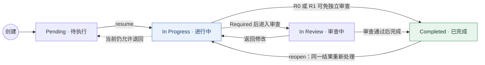
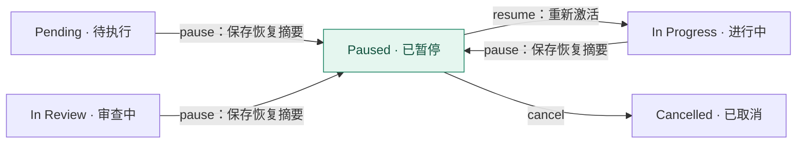
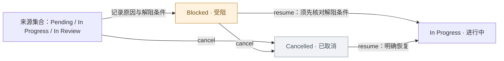

# 任务系统状态转换图

本图按当前 `task-core.js` 实现绘制。三个面板共同描述同一套七状态系统；来源集合不是额外状态。图中不把尚未实施的优化建议当成现有行为。忽略同状态重复写入，覆盖 21 条不同状态之间的转换；另画创建入口。

## 01 主流程

进入 In Review 必须已有 Required 审查门禁；返回 In Progress 不等于问题已解决。R2 必须独立审查；R0/R1 只有无显式或既有审查义务且有充分依据时，才可跳过独立审查。完成仍必须满足目标、结果证据、当前评估、最终验证及适用的 Topic/Queue 条件。

虚线表示当前运行时仍允许 `In Progress → Pending`，并不表示“暂停”。之前提出的禁止误用 Pending 尚未实现。Completed 不能普通 resume，必须按同一结果的 reopen 规则重新处理；重开已完成子任务前，父任务必须恢复为活动状态。

## 02 主动暂停与恢复

Paused 必须由专用 pause 入口连同完整恢复摘要写入，普通 status 不能代替。摘要包含停止点、部分成果及位置、验证、剩余工作、决策、下一步、依赖和跨电脑转移要求。恢复后仍要核对现场、成果及权限；摘要不证明文件已同步。暂停及恢复使旧验证与评估失效，保留 Required 审查义务和未解决 finding。

Paused 不能直接进入 Pending、In Review、Blocked 或 Completed。发现缺失依赖时，按恢复流程重新激活、记录具体缺口和解阻条件，再进入 Blocked；不能声称工作已完整恢复。没有 Suspended 状态；用户说 suspend、stash、暂存或搁置时，任务指引应将主动暂停意图归入 Paused。

## 03 阻断与取消

来源集合的两条箭头分别展开为三个来源状态各自的转换。Blocked 必须有 Block 原因与可观察解阻条件，不能直接 pause 绕过障碍。Cancelled 可恢复，但没有完整暂停摘要的保证。

审查停滞的 finding 未满足解阻条件时，即使调用 resume 也会被拒绝。Queue 不跳过 Paused、Blocked 或 Cancelled 子任务；暂停父任务不会递归暂停子任务或停止仍运行的 Agent。

## 当前转换清单

| 来源状态 | 当前可转入状态 |
| --- | --- |
| Pending | In Progress、Blocked、Cancelled、Paused |
| In Progress | Pending、In Review、Blocked、Cancelled、Paused、Completed |
| In Review | In Progress、Blocked、Cancelled、Paused、Completed |
| Blocked | In Progress、Cancelled |
| Paused | In Progress、Cancelled |
| Cancelled | In Progress |
| Completed | In Progress（仅 reopen） |

这里的“可转入”均受具体入口、授权和门禁约束。审查门禁的 Required/Skipped/Passed/Approved 是独立字段，不是上述任务状态；“等待用户确认”和“停止模型运行”也不是 Paused 的替代状态。

## 实现依据与验证范围

- [任务运行时](../../../../../skills/meta/csl-tasks/shared/lib/task-core.js)：`setState`、`pauseTask`、`resumeTask`、`reopenTask`、`requireCompletable`、`finalizeTask`。
- [暂停与恢复指引](../../../../../skills/meta/task/references/pause-resume.md)。
- 图示覆盖当前七状态、21 条异状态转换及创建入口；这是源码与图文对照，不是新一轮运行时行为测试或全新 Agent 回放。
