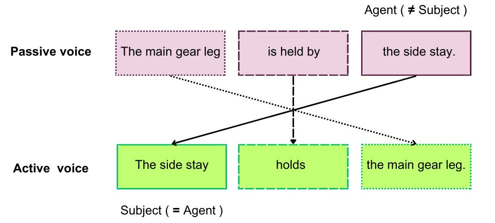

## Section 1 – Words

### Summary of the rules

Which words can you use?

### Rule 1.1 Use words that are:

- Approved in the dictionary
- Technical nouns
- Technical verbs.
Part of speech

### Rule 1.2 Use approved words from the dictionary only as the specified part of speech.

Approved meaning

### Rule 1.3 Use approved words only with their approved meanings.

Forms of verbs and adjectives

### Rule 1.4 Use only the approved forms of verbs and adjectives.

Technical nouns

### Rule 1.5 You can use words that you can include in a technical noun category.

### Rule 1.6 Use a word that is not approved in the dictionary, only when it is a technical noun or part of a technical noun.

### Rule 1.7 Do not use words that are technical nouns as verbs.

### Rule 1.8 Use technical nouns that are approved in your company, industry, or subject field.

### Rule 1.9 When you must select a technical noun, use one which is short and easy to understand.

### Rule 1.10 Do not use regional, slang, or jargon words as technical nouns.

### Rule 1.11 Do not use different technical nouns for the same item.

Technical verbs

### Rule 1.12 You can use verbs that you can include in a technical verb category.

### Rule 1.13 Do not use technical verbs as nouns.

Spelling

### Rule 1.14 Use American English spelling unless other official directives tell you differently.

Which words can you use?

### Rule 1.1 Use words that are:

- Approved in the dictionary
- Technical nouns
- Technical verbs.

Simplified Technical English (STE) has a controlled dictionary (part 2) that gives the words most
frequently used in technical writing. You can also use words that are not in the dictionary if you can
include them in the specified categories of technical nouns and technical verbs.
A technical noun is a noun term that refers to a specified concept and is applicable to a subject
field. A technical verb is a verb term that also refers to a specified concept or process and is
applicable to a subject field.
Examples:
The word “use” is an approved verb in the dictionary.
The word “engine” is a technical noun.
The word “ream” is a technical verb.

The dictionary also gives a selection of words that are not approved, with examples that show how
to use alternative words.

In the context of ISO 1087:2019, “subject fields” refer to specific domains or areas of
knowledge that have specialized vocabularies.

Technical nouns and technical verbs are usually included in your company glossary or
terminology database. Always refer to these sources, and to the specified rules in this
section, for the correct selection of words.

Part of speech

### Rule 1.2 Use approved words from the dictionary only as the specified part of speech.

In the dictionary, each approved word has a specified part of speech. When you use an approved
word, make sure that you use it only as the specified part of speech.
Examples:
“Test” is an approved noun, but not an approved verb.
STE: Test B is an alternative to test A.

Non-STE: Test the system for leaks.
STE: Do the leak test of the system.
or
STE: Do a test for leaks in the system.

“Dim” is an approved adjective, but not an approved verb.
STE: A dim light comes on.

Non-STE: Dim the lights.
STE: Set the lights to the dim position.

Some words are approved as more than one part of speech. For example, “clean” is an approved
verb and an approved adjective. The position of the word in the sentence shows its function (and
its meaning) because verbs and adjectives have different positions.
STE: Clean the inner surface of the container.
(“Clean” is a verb here.)

STE: Make sure that the area is clean.
(“Clean” is an adjective here.)

“Acceptable” is an adjective that is not approved. The dictionary gives three approved alternatives
that have the same part of speech. You can use one of these alternatives to replace the word
“acceptable” in the sentence with a word-for-word replacement.
Non-STE: A value of 2 mm is acceptable.
STE: A value of 2 mm is permitted.

“Operable” is an adjective that is not approved. The dictionary gives an approved alternative that
has a different part of speech: “operate” as a verb. Thus, you must use a different sentence
construction.
Non-STE: Make sure that the valve is operable.
STE: Make sure that the valve can operate.

When you replace a word, always make sure that the approved alternative you select does not
change the meaning of the sentence. If the meaning changes, select a different word or use a
different sentence construction.

Each word in the dictionary has its part of speech in parentheses, abbreviated as specified in
the introduction to the dictionary.

If a word that you want to use is not in the dictionary:
- Find that word in an English dictionary.
- Find which is the best synonym that is approved in the STE dictionary.
- Use the approved STE word or find a different sentence construction with other
approved words.

Approved meaning

### Rule 1.3 Use approved words only with their approved meanings.

Each approved word in the dictionary has a specified approved meaning. Some of these words can
have more restricted meanings compared with their meanings in standard English. Always use the
approved words only with their approved meanings.
Examples:
The approved meaning of the verb “follow” is “come after, go after.”
STE: Do the procedures that follow:

STE: Follow the green lights to the nearest staircase.

You cannot use the verb “follow” with other meanings that are not approved.
Non-STE: Follow the safety instructions.
In this sentence, always use “obey” with the approved meaning “to do that which the procedures or
instructions tell you.”
STE: Obey the safety instructions.

Forms of verbs and adjectives

### Rule 1.4 Use only the approved forms of verbs and adjectives.

```text
The dictionary gives each approved verb together with its approved forms. The dictionary also
gives the approved adjectives in their base form, together with their comparative and superlative
forms in parentheses where applicable.
Example - Verbs:
  REMOVE (v),
  REMOVES,
  REMOVED,
  REMOVED
  This word tells you that you can use the approved verb “remove” as follows:
    Infinitive/Imperative      Simple present       Simple past tense   Past participle form
    forms                      tense                                    (as an adjective)
    (To) Remove/Remove         Remove(s)            Removed             Removed
 The past participle form of the verb is usually the same as the simple past tense. Thus, the
 dictionary gives it two times.
```

```text
Example - Adjectives:
     SLOW (adj)
     (SLOWER,
     SLOWEST)
This word tells you that you can use the approved adjective “slow” as follows:
      Base form                   Comparative form                  Superlative form
      Slow                        Slower                            Slowest
Adjectives that make their comparative and superlative forms with “more” and “most” do not have
these forms in the dictionary. This is because “more” and “most” are approved words.
```

Technical nouns

### Rule 1.5 You can use words that you can include in a technical noun category.

```text
A technical noun is a noun term that refers to a specified concept and is applicable to a subject
field.
The dictionary does not include technical nouns because there are too many, and each subject
field uses different technical nouns for their texts.
You can find many of these technical nouns in your company glossary or terminology database.
STE gives you a list of categories, with examples, to help you:
   - Select technical nouns to put in your company glossary or terminology database.
   - Use technical nouns correctly.
You can use technical nouns in procedural and descriptive writing if you can include them in one or
more of these twenty-two categories.
1.    Official parts information
      Terms that refer to all design items. For example, technical nouns included in illustrated parts
      catalogs or engineering drawings.
      bolt, cable, clip, conductor, contact, engine, ferry tank, filter, hatch, hazard lights, indicator,
      light, logo, oil seal, prelubricated seal, pipe, propeller, retractor link, screw, switch, transceiver
2.    Vehicles or machines, and locations on them
      Terms that refer to all types of vehicles and machines, and the locations that are part of these
      units.
      aircraft, aircraft carrier, airframe, airplane, bicycle, cabin, car, cargo compartment, cargo hold,
      cockpit, deck, engine room, fuselage, helicopter, galley, lifeboat, overhead panel, ship,
      submarine, tank, train, truck, wing, wing root
```

```text
3.   Tools and support equipment, their parts, and locations on them
     Terms that refer to all types of tools, support equipment, their parts, and locations that are part
     of these items.
     access ladder, blade, brush, cap, chock, clamp, cover, display, drill, file, gauge (gage),
     graduated beaker, handle, jack, label, rigging pin, roller, rope, rung, shaft, stand, tag, test rig,
     torque wrench, trestle
4.   Materials, consumables, and unwanted material
     Terms that refer to materials, consumable items, and other substances that can cause
     contamination or malfunctions.
     acid, adhesive, aluminum alloy, ammunition, compound, copper, debris, detergent, dirt,
     disinfectant, dust, foam, foreign object, fuel, grease, hazardous substances, hazardous waste,
     metal, metallic coating, oil, paint, penetrant spray, plastic, primer, sealant, sealing, soap,
     stainless steel, tape, waste, water, wire
5.   Facilities, infrastructure, and logistic procedures
     Terms that refer to the management, structure, and operations of physical facilities,
     infrastructure systems, and logistic procedures. For example, areas for utility systems,
     transportation networks, storage, distribution processes, and operational logistic workflows.
     airport, apron, base, building, camp, dock, engine shop floor, flight simulator, gate, handling,
     hangar, packaging, packing, port, service bay, shipping, shop, store, storage, transport
6.   Systems, components and circuits, their functions, configurations, and parts
     Terms that refer to the structure, operation, composition, and system design.
     air conditioning, amplifying circuit, armament, audio, aural warning system, collapsed position,
     exhaust, flight management, hardware, inhibiting signal, injection, inlet, input frequency, latch,
     pedal, power unit, pump, reverse mode, reverse position, standby mode, upright position, vent
7.   Mathematical, scientific, engineering terms, and formulas
     Terms that refer to concepts, design, calculations, or methodologies.
     acceleration, allowance, astronomy, atom, average, biochemistry, biology, biome, burr,
     capacitance, carbon, category, cavitation, center, circle, coefficient, combination,
     configuration, conversion, count, critical temperature, curve, cycle, defect, degree,
     deceleration, density, diameter, displacement, duty cycle, elapsed time, electricity, energy,
     exponent, failure, ferry flight, flutter, force, fumes, genetics, geology. geophysics, graph,
     gravity, hardness, heat treatment, idle speed, ignition, inhibition, instrumentation, interference,
     issue, light, line replaceable unit, load, loss, measurement, modification, momentum, motoring,
     overhaul, oversized hole, oxygen, performance, phase, polarity, power, pressure, process,
     radius, rating, ratio, reduction, relative angular position, resistance, scan, shutdown, signal,
     specific gravity, stall, standard, steam, stiffness, strength, suction, temperature, tension,
     thread, tightness, torque, toxic property, vapor, voltage, water vapor, “C = (A - B) - 0.063 mm”
8.   Navigation and geographic terms
     Terms that refer to positions, directions, or locations related to mapping, routing, or spatial
     orientation.
     air, altitude, attitude, axis, bank, clearance, climb, coordinates, critical approach, datum, delay,
     deviation, drag, east, France, glideslope, gradient, heading, landing, leeway, Lima, north,
     pitch, roll, skid, south, west
```

```text
9.   Numbers, units of measurement and time (and their symbols)
     Terms that refer to quantitative data, measurements, or time-related information.
     92, 303, ampere (A), degree (), first (1st), half (½), hour (h), kilogram (kg), knot, liter (L or l),
     meter (m), mile, minute ('), month, ohm (), one, one-quarter (¼), second (), second (s),
     second (2nd), square inch (sq.in.), spring, third (3rd), three, year, winter, zero
10. Quoted text
    Terms that refer to texts that you cannot change in technical writing. For example, texts on
    placards, labels, signs, markings, and display units.
    abort button, EXIT sign, INOP system, OXYGEN pushbutton switch, ON position, NEXT
    button, FAULT legend, NO STEP marking, FASTEN SAFETY BELT sign, WEAR
    PROTECTIVE CLOTHING sign
11. Professional roles, individuals, groups, organizations, and geopolitical entities
    Terms that refer to professional functions, names of persons, organizations, companies,
    teams, sovereign states, or entities related to processes, responsibilities, or decision-making.
    air traffic control, British Broadcasting Corporation (BBC), captain, commander, copilot, crew,
    crew chief, European Aviation Safety Agency (EASA), Federal Aviation Administration (FAA),
    John Kirkman, manufacturer, operator, Transport Canada Civil Aviation (TCCA), United States
    of America (USA)
12. Parts of the body
    Terms that refer to anatomical features or functions related to medical, biological, or
    ergonomic contexts.
    blood, digestive system, ear, eyes, hair, hand, head, lung, mouth, respiratory tract, skin,
    stomach
13. Common personal effects, food, and beverages
    Terms that refer to everyday personal items and types of food and beverage.
    beans, bread, cigarette lighter, clothing, coffee, flour, footwear, high-heeled shoes, jewelry,
    lipstick, matches, milk, mineral water, nail scissors, perfume, pizza, shampoo, wine
14. Medical terms
    Terms that refer to medical conditions, procedures, or anatomical structures.
    allergy, aspirin, asthma, blood poisoning, breathing, circulation, dermatitis, diabetes, dizziness,
    female, hallucination, headache, heart rate, irritation, male, medication, nausea, pneumonia,
    pregnancy, pulse, skin irritation, virus
15. Official documents, parts of documentation, standards, and guidelines
    Terms that refer to different types of official documents and their structural parts. For example,
    manuals, technical records, standards, specifications, and regulations requirements.
    Acceptance Test, Activation/Deactivation, Allowable Damage, attention, caution, chapter,
    Checklist, Class, Cleaning, Compass Correction Card, danger, data module, Description and
    Operation, diagram, engine logbook, Federal Aviation Regulations, Fault Isolation, figure,
    flowchart, font, Functional Test, Ice and Rain Protection, Inspection/Check, issue, language
    policy, letter, maintenance planning, maintenance practice, maintenance records, Normal
    Braking, note, notice, packaging, page, paragraph, parentheses, post-flight report, post-mod,
    pre-mod, prerequisite, preservation, reference, Removal/Installation, Required Conditions,
    Repair Scheme, recommendation, revision, section, Service Bulletin, Standard Practices
    Manual, storage, Structural Repair Manual, table, test procedure, training material,
    Transportation, valid welding certificate, warning
```

16. Environmental and operational conditions
Terms that refer to external factors and operating parameters that are related to systems or
processes.
atmosphere, cloud, day, daylight, ice, hail, humidity, lightning, moisture, night, rain, relative
humidity, sand, snow, storm, turbulence, volcanic ash, wind
17. Colors
Terms that refer to colors that identify color-related properties, or show color attributes in
different contexts.
beige, black, cyan blue, dark brown, gray, green, magenta, light green, orange, red, white,
yellow
Colors are adjectives, but STE identifies them as technical nouns. Comparative and
superlative forms of colors (for example, blacker, the reddest) are not permitted in STE.

18. Damage terms
Terms that refer to types of defects or degradation and give information about malfunctions.
buckle, chafing, corrosion, crack, crack propagation, deformation, dent, discoloration,
distortion, erosion, fracture, fraying, galling, kink, nick, score, scratch, stain, spurious fault
message
19. Computer science, information and communication technology
Terms that refer to technological concepts, systems, or components in this subject field.
add-in, add-on, AI, arrow, artificial intelligence, authentication, backup, backup file, bookmark,
chatbot, content, cursor, cybersecurity, database, deep learning, dialog check box,
digitalization, digitization, e-mail, embedding, field, file, firewall, hallucination, HTML, icon,
interface, internet, laptop, large language model, local operation, machine learning, memory,
menu, metadata, mouse, network, operating system, phone, plug-in, pre-loaded software,
preset value, prompt engineering, remote operation, screen, search engine, smartphone,
status bar, store, tablet, token, toolbar, touchscreen, tweet, tuning, update, voice mail, XML
20. Civil and military operations
Terms that refer to concepts and activities, service delivery, product management, and
customer and life-cycle support in civil and military operations.
armed forces, assault, bomb, bullet, checkpoint, combat plan, contractor, customer, customer
support, customer service, deployment, echelon, ejection seat, end item, end user,
evacuation, formation, ground zero, gun, Integrated Product Support (IPS), know-how,
lifecycle, machine gun, maintenance concept, mission, obsolescence, operator, Original
Equipment Manufacturer (OEM), patrol
21. Law and regulations
Terms that refer to legal and regulatory texts. For example, contracts, warranty texts,
certificates, standards and specifications, and legal papers.
action, ambiguity, appeal, arbitration, bankruptcy, communication, competence, compliance,
concession, contract, court, damages, explanation, explanatory text, impeachment, jury, law,
judgement, jurisdiction, purpose, recommendation, scope, serious incident, serious offense,
signature, statute, term, trade, waiver, wording
22. Animals, plants, and other life forms
Terms that refer to biological entities in technical and environmental contexts.
bacteria, bird, cassowary, cat, conifer, cow, dog, emu, fern, ferret, fungi, horse, insect, leopard,
monkey, moss, mouse, pocket gopher, rose, termite, wombat

The technical nouns in their related categories are only examples. Rule 1.5 does not give a
full list of all possible technical nouns. The listed words in each category have uppercase
letters only when it is necessary. For example, official identifications, titles, and
abbreviations.

### Rule 1.6 Use a word that is not approved in the dictionary, only when it is a technical noun or part of a technical noun.

The dictionary includes some words that you cannot use because they are not approved. But if you
can put these words in an applicable category of technical nouns, you can use them as technical
nouns in some contexts.
Examples:
The word “base” is not approved in the dictionary and its alternative is “bottom (n).”
Non-STE: Make sure that the two spigots at the base of the unit engage.
(“Base” is not permitted when it is related to a surface.)
STE: Make sure that the two spigots at the bottom of the unit engage.
But you can use “base” as a technical noun.
STE: The base of the triangle is 5 cm.
(“Base” is a technical noun, category 7, mathematical, scientific, engineering
terms, and formulas.)
The same word “base” can go into different categories of technical nouns. This condition occurs
when you use the word “base” with different meanings in different contexts.
Example:
STE: Access to the base is permitted between 9 a.m. and 6 p.m.
(“Base” is a technical noun, category 5, facilities, infrastructure, and logistic
procedures.)

“Backup” is not approved in the dictionary and its alternatives are “emergency (n)” and “auxiliary
(adj).” But you can use “backup” as a technical noun.
Example:
STE: Do the backup of the computer at regular intervals.
(“Backup” is a technical noun, category 19, computer science, information and
communication technology.)

“Backup” is a one-word technical noun. But you can also write “backup file,” a two-word technical
noun.
Examples:
STE: Keep the backup file in a safe area.
(“Backup file” is a technical noun, category 19, computer science, information and
communication technology.)

Non-STE: For this procedure, make sure that one person is available as backup.
(“Backup” is not permitted and you cannot use it in this context.)
STE: Two persons are necessary to do this procedure.
(Different sentence construction)

“Main” is a word that is not approved, and its alternative is “primary (adj).”
Examples:
Non-STE: The laptop has these main parts:
(“Main part” is not a technical noun, and it is correct to replace “main” with
“primary.”)
STE: The laptop has these primary parts:
But you can use “main” as part of a technical noun.
STE: Retract the main landing gear.
(“Main landing gear” is a technical noun. It is incorrect to replace “main” with
“primary” here, because “primary landing gear” is not the technical noun that is
approved in your company, industry, or subject field.)

If a word is not in the dictionary, you can use it if it is part of a technical noun. In the example that
follows, “angular” and “position” are approved but “relative” is not in the dictionary.
Example:
STE: This procedure gives instructions to identify the relative angular positions of the
power-turbine rotor disks.
(You can use “relative” as part of a technical noun, category 7, mathematical,
scientific, engineering terms, and formulas.)

### Rule 1.7 Do not use words that are technical nouns as verbs.

Use a technical noun only as a noun or as an adjective that is part of a different technical noun. Do
not use the same word as a verb.
Examples:
“Oil” is a technical noun, category 4, materials, consumables, and unwanted material. Do not use
“oil” as a verb. Use a different sentence construction that lets you use “oil” as a technical noun.
Non-STE: Oil the steel surfaces.
STE: Apply oil to the steel surfaces.

“Snow” is a technical noun, category 16, environmental and operational conditions. Do not use
“snow” as a verb. Use a different sentence construction that lets you use “snow” as a technical
noun.
Non-STE: If you think it will snow, make sure that the vehicle is in the applicable
configuration.
STE: If you think that snow will fall, make sure that the vehicle is in the applicable
configuration.

Words that can be technical nouns and technical verbs
In some contexts, the same word can be a technical noun and a technical verb. This condition
occurs when you can put this word in a technical noun category (rule 1.5) and in a technical verb
category (rule 1.12).
Examples in STE:
If the surface is hard, use a carbide drill.
(“Drill” is a technical noun, rule 1.5, category 3, tools and support equipment, their parts, and
location on them.)

Drill a hole at the intersection of the two lines.
(“Drill” is a technical verb, rule 1.12, category 1 a), manufacturing processes, remove material.)

### Rule 1.8 Use technical nouns that are approved in your company, industry, or subject field.

If your company, industry, or subject field, has an approved technical noun for a system,
component, part, or process, use that technical noun. Usually, such technical nouns are included in
official parts information and in company documentation.
Example:
STE: The front panel of the phone has a touchscreen and a home button.
(“Touchscreen” and “home button” are technical nouns that are approved in your
company, industry, or subject field.)

### Rule 1.9 When you must select a technical noun, use one which is short and easy to understand.

When there is no technical noun that is approved in your company, industry, or subject field, select
one that is short (not more than three words) and easy to understand.
Example:
Non-STE: Remove the four stainless steel pan head machine screws (10) that attach the
metallic machined flange (15) to the front housing cover (20).
STE: Remove the four screws (10) that attach the flange (15) to the cover (20).
In this example, it is sufficient to use the words “screws,” “flange,” and “cover.” This is because
these parts have index numbers, and the related illustration clearly identifies them. Differently, add
one or two adjectives to the noun to help your reader understand.

### Rule 1.10 Do not use regional, slang, or jargon words as technical nouns.

There can be technical words that only persons in confined regions or geographical areas use.
These words are not easy to understand for persons who are from a different region or area.
When you select technical nouns, always use well-known words.
This rule is also applicable to technical slang or jargon words. If only a small number of persons
understand a word, it will cause confusion and non-effective communication.
Examples:
Non-STE: During logging operations, attach a choker to the heavy machinery to hold the logs
in their position.
(A “choker” is a type of cable used in logging operations to attach logs during
transportation. It is a term used in some regions of North America and Canada,
Northern Europe, and New Zealand. Its meaning is not immediately clear to the
reader.)
STE: During logging operations, attach a cable to the heavy machinery to hold the logs
in their position.

Non-STE: After the firmware update, do not brick the router.
(“Brick” is technical slang in information technology, with the meaning of “to make
a device non-operational.” Its meaning is not immediately clear to the reader.)
STE: After the firmware update, do not set the router to OFF.

Non-STE: Remove your gear from the work area.
(“Gear” is technical jargon that refers to tools and equipment, and its meaning is
not immediately clear to the reader.)
STE: Remove your tools and equipment from the work area.

### Rule 1.11 Do not use different technical nouns for the same item.

When you select a technical noun, do not use a different technical noun in other parts of your text
to refer to the same item.
Example:
Non-STE: 1. Make sure that the servo control unit is in the open position.
2. Do the operational test of the actuator.
3. Disconnect the control unit from the test rig.
STE: 1. Make sure that the actuator is in the open position.
2. Do the operational test of the actuator.
3. Disconnect the actuator from the test rig.
In the non-STE example, “servo control unit,” “actuator,” and “control unit” refer to the same item.
Use the technical noun that is approved in your company, industry, or subject field. If, as in the
example, the technical noun is “actuator,” then always use this technical noun in your text.

Technical verbs

### Rule 1.12 You can use verbs that you can include in a technical verb category.

```text
A technical verb is a verb term that refers to a specified concept or process and is applicable to a
subject field.
The dictionary does not include technical verbs because there are too many, and each subject field
uses different technical verbs for their texts.
You can find many of these technical verbs in your company glossary or terminology database.
STE gives you a list of categories, with examples, to help you:
   - Select technical verbs to put in your company glossary or terminology database.
   - Use technical verbs correctly.
Technical verbs must obey the same rules as other approved verbs in STE. Refer to section 3.
You can use technical verbs in procedural and descriptive texts if you can include them in one or
more of these four categories.
1. Manufacturing processes
   Terms that give instructions and information to:
   a)   Remove material:
        drill, grind, mill, ream, unsolder
   b)   Add material:
        flame, insulate, remetal, retread
   c)   Attach material:
        braze, crimp, solder, weld
```

```text
  d)   Change the mechanical strength, the structure, or the physical properties of a
       material:
       anneal, cure, decay, freeze, heat-treat, magnetize, normalize, vaporize
  e)   Change the surface finish of a material:
       buff, burnish, dress, passivate, plate, polish
  f)   Change the shape of a material:
       blend, cast, extrude, spin, stamp
2. Computer processes and applications
  Terms that give instructions and information for:
  a) Input and output processes:
     click, digitize, enter, press, print, swipe, tap, type
  b) User interface and application processes:
     clear, close, copy, cut, delete, deselect, disable, drag, drag and drop, enable, encrypt,
     erase, filter, highlight, invalidate, maximize, minimize, navigate, open, paste, save, scroll,
     sort, store, tweet, validate, zoom in, zoom out
  c) System operations:
     abort, boot, communicate, debug, download, format, install, load, manage, process, reboot,
     update, upgrade, upload
3. Instructions and information for applicable subject fields
  Terms that give instructions and information in these contexts:
  a) Engineering, mathematical, and scientific
     bisect, compensate for, convert, detect, float, modulate, radiate, transform, sink
  b) Medical
     disinfect, intubate, operate, prescribe, sanitize, sterilize
  c) Civil and military operations
     aim, arm, detect, disable, dry-motor, enable, explode, fire, inhibit, intercept, lase, load,
     lock on, unlatch, unload, wet-motor, parachute
  d) Navigation
     approach, descend, deviate, fly, hover, land, maintain, navigate, retrim, take off, trim,
     respond, taxi
  e) Automotive and railway
     accelerate, brake, couple, crank, crash, decouple, dispatch, drift, inflate, park, qualify, steer
  f)   Energy, oil, and gas
       compress, distill, drill, emit, extract, inject, pump
4. Law and regulations
  Terms that give instructions and information only for legal and regulatory texts. For example,
  contracts, warranty texts, certificates, standards and specifications, and legal papers.
  acknowledge, comply with, communicate, conform to, describe, enforce, explain, meet (a
  requirement), inform, modify, notify, omit, regulate, sign, supersede, understand, waive (for
  inspection and requirements)
```

The technical verbs in their related categories are only examples. Rule 1.12 does not give a
full list of all possible technical verbs.
If there is an approved verb in the dictionary that accurately gives the instruction or the information,
use the approved verb. Do not use a technical verb if it is possible to write the same sentence with
the words (verbs and other related words) that are approved in the dictionary.
Examples:
Non-STE: If you detect broken wires, repair them.
(“Detect” is not approved and cannot be a technical verb in this context.)
STE: If you find broken wires, repair them.
But you can write:
STE: The security scanner detects metal objects.
(“Detect” is the correct technical verb in this context.)

If you must use technical verbs, use only technical verbs that are correct in your context. Do not
use technical verbs that are general or not clear.
Example:
Non-STE: Machine the hole until it has a diameter of 8.00 +/- 0.003 mm.
STE: Ream the hole until it has a diameter of 8.00 +/- 0.003 mm.

Do not use a technical verb if it is not necessary. If it is possible, use a verb that is approved in the
dictionary and an applicable technical noun.
Examples:
“Clamp” is a technical noun, category 1, official parts information. Do not use “clamp” as a technical
verb.
Non-STE: Clamp the cable in position.
STE: Put clamps on the cable to hold it in position.

“Grease” is a technical noun, category 4, materials, consumables, and unwanted material. Do not
use “grease” as a technical verb.
Non-STE: Grease the fasteners.
STE: Apply grease to the fasteners.

“Wire” is a technical noun, category 1, official parts information. Do not use “wire” as a technical
verb.
Non-STE: Wire the cable to the structure.
STE: Attach the cable to the structure with wire.

Words that are not approved but that can be technical verbs
The dictionary includes some words that, although not approved, can be technical verbs if you can
put them in the specified categories.
Examples:
STE: Enter your password.
(“Enter” is a technical verb, category 2 a), computer processes and applications,
input and output processes.)
Non-STE: Do not enter the engine test area without approval.
(“Enter” is not permitted when it is in a different context.)
STE: Do not go into the engine test area without approval.

STE: If the tower does not respond, use a different channel.
(“Respond” is a technical verb, category 3 d), instructions and information for
applicable subject fields, navigation.)
Non-STE: If the instrument fails to respond, do a test.
(“Respond” is not permitted when it is in a different context.)
STE: If the instrument does not operate correctly, do a test.

### Rule 1.13 Do not use technical verbs as nouns.

In English, words that look the same do not always have the same function in a sentence. Use
technical verbs only as verbs, not as nouns.
Example:
Non-STE: Give the hole 0.20-inch ream.
STE: Ream the hole to a 0.20-inch dimension.
But you can use the past participle form of technical verbs as adjectives.
Example:
STE: Lubricate the reamed hole.
(The adjective “reamed” is the past participle form of the technical verb “ream.”
“Reamed hole” is a technical noun.)

Words that can be technical verbs and technical nouns
In some contexts, the same word can be a technical verb and a technical noun. This condition
occurs when you can put this word in a technical verb category (rule 1.12) and in a technical noun
category (rule 1.5).
Examples:
STE: Make sure that the plate is not damaged.
(“Plate” is a technical noun, category 1, official parts information.)

STE: There are two methods to plate the ring nut (2).
(“Plate” is a technical verb, category 1 c), manufacturing processes, attach
material.)

Spelling

### Rule 1.14 Use American English spelling unless other official directives tell you differently.

Use the spelling specified in the STE dictionary (American English spelling).
Use a different spelling only if other technical publication specifications, style guides, contracts, or
other official directives are applicable.
Examples:
Non-STE: The door is made of carbon fibre reinforced plastic.
(“Fibre” is British English spelling.)
STE: The door is made of carbon-fiber-reinforced plastic.
(“Fiber” is American English spelling.)

Non-STE: Change the colour of the display.
(“Colour” is British English spelling.)
STE: Change the color of the display.
(“Color” is American English spelling.)

If there is quoted text that has British English spelling, for example on a computer screen, do
not change the spelling. Keep the quoted text as it is. Refer to Rule 8.6 which tells you how
to use quoted texts correctly.

## Section 2 – Multi-word nouns

### Summary of the rules

Multi-word nouns

### Rule 2.1 Write multi-word nouns of no more than three words.

### Rule 2.2 When a technical noun has more than three words, write it in full.

Then, you can use one of these methods to make the technical noun clear:
- Give a shorter form of the technical noun.
- Use hyphens (-) between words that you use as one unit.

Multi-word nouns

### Rule 2.1 Write multi-word nouns of no more than three words.

```text
In English, you can use one or more words to describe or modify a noun.
Technical texts can contain long groups of words that have the function of one part of speech in a
sentence. Usually, these groups of words are made of nouns and/or adjectives and are the subject
or the object in a sentence. Such groups of words are known as multi-word nouns.
General examples:
       Horizontal cylinder pivot bearing                          (a multi-word noun of 4 words)
       Stainless steel corrosion protection strips                (a multi-word noun of 5 words)
       Actuator operating rod                                     (a multi-word noun of 3 words)
```

Long multi-word nouns are not easy to understand because the words in the multi-word noun can
connect to each other differently. The main noun, or head noun of the group, is usually the last
word of the multi-word noun. When the connections between words are not clear, ambiguity
occurs. As a result, short multi-word nouns are easier to understand.
Runway light connection
(This example shows a short multi-word noun (3 words). The main noun is “connection.”)
Runway light connection resistance calibration
(This example shows a long multi-word noun (5 words). The main noun is “calibration.”)
The long multi-word noun in the example does not tell the reader the relation between “runway”
and “calibration.” The reader must understand four modifiers before the main noun “calibration.”
Long multi-word nouns can cause problems for non-native English readers because, in some
languages, the main noun comes first in the multi-word noun. When a multi-word noun has more
words, it is less clear.
To help your reader, keep multi-word nouns to a maximum of three words.

To keep multi-word nouns short, you can use prepositions (for example, “of,” “on,” “in,” and “for”)
and explain the multi-word nouns.
Examples:
Non-STE: Runway light connection resistance calibration. (5 words)
STE: Calibration of the resistance of the runway light connection.
(1 word, 1 word, and 3 words)

Non-STE: Install the forward turbine overheat thermocouple terminal tags. (6 words)
STE: Install the terminal tags on the forward overheat thermocouple of the turbine.
(2 words and 3 words)
Non-STE: Remove the engine transmission housing attachment bolts. (5 words)
STE: Remove the bolts that attach the transmission housing to the engine.
(1 word, 1 word, 2 words, and 1 word)
Non-STE: Adjust to obtain door operating rod alignment with the attachment point. (4 words)
STE: Adjust the door operating rod until it aligns with the attachment point.
(3 words and 1 word)

### Rule 2.2 When a technical noun has more than three words, write it in full.

Then, you can use one of these methods to make the technical noun
clear:
- Give a shorter form of the technical noun.
- Use hyphens (-) between words that you use as one unit.

A long multi-word noun can be a long technical noun, or it can be a combination of shorter
technical nouns. Frequently, it is not possible to divide technical nouns into smaller parts because
they are the technical nouns that your company, industry, or subject field uses. Thus, you must
write technical nouns as they are, in their approved form.

Method 1 - Shorter form of technical nouns
If a long technical noun comes from an official document (for example, an engineering drawing or
an illustrated parts catalog), write it in full the first time that it occurs in the text. Then, if it is
possible, explain the technical noun and in the remaining text of your document, use a shorter form
or an approved abbreviation.
Examples in STE:
Before you do this procedure, engage the ramp service door safety connector pin (the pin that
holds the ramp service door, referred to in this procedure as the “safety connector pin”).
In this example, you write “ramp service door safety connector pin” in full. Then, after an
explanation, you give a shorter technical noun: “safety connector pin.” This shorter technical noun
has three words and obeys rule 2.1.

The Main Fuel Metering Unit (MFMU) is an aluminum alloy unit that includes a Main Engine
Control Unit (MECU) and a Distribution Block (DB). The MFMU is installed in the engine bypass
duct and operates in the engine fuel system. The function of the MFMU is to meter and supply
the fuel from the Main Engine Fuel Pump (MEFP) to the fuel manifolds and the starter jets. The
Digital Engine Control Unit (DECU) sends electrical signals to operate the MFMU.
In this example, the explanation is not necessary because the text gives all the necessary
information about the unit. You write all official technical nouns that include more than three nouns
in full the first time that they occur. Then, in the remaining parts of the text, you use their related
approved abbreviations.

If an approved technical noun includes three words or less, it is not necessary to use
abbreviations.
Example:
Do not write: The primary parts of the valve are:
- The DA (8)
- The PVA (15)
- The BA (17)
- The VB (20).
WRITE: The primary parts of the valve are:
- The diaphragm assembly (8)
- The poppet valve assembly (15)
- The bush assembly (17)
- The valve body (20).

```text
You can use abbreviations that come from your official company documentation but be careful. A
text full of abbreviations in a procedure, although shorter, is not easy to read.
Example:
    Do not write:      A. Remove the DA (8) from the VB (20).
                       B. Remove the PVA (15) from its seat.
                       C. Remove the BA (17) from the VB (20).
         WRITE:        A. Remove the diaphragm assembly (8) from the valve body (20).
                       B. Remove the poppet valve assembly (15) from its seat.
                       C. Remove the bush assembly (17) from the valve body (20).
```

```text
Method 2 - Hyphens (-) between the words that you use as one unit
A hyphen is a punctuation mark that connects words or parts of words. You can use hyphens
between words to show how related words operate as one unit. This method will make the
multi-word nouns that you use agree with rule 2.1. Hyphenated words always count as one word.
Examples in STE:
    Make sure that the cutoff-switch power connection is safe.                                 (3 words)
```

```text
    Inspection of the lavatory rapid-decompression device.                                     (3 words)
```

Make sure that you do not connect words which are not related, because this hyphen will change
the meaning of the multi-word noun. If you are not sure, only explain the multi-word noun. Then,
use a shorter form, or an official approved abbreviation.
If an approved technical noun includes hyphens, do not change it. If it is too long, write it in full the
first time it occurs and then use the recommended method (shorter technical nouns) specified in
this rule.
Do not use hyphens to make groups of more than three words. If you use hyphens for all the
words, this multi-word noun will not be easy to read and understand.
Example:
Non-STE: Move the main-gear-door-retraction-winch handle. (2 words, but not correct)
STE: Move the main-gear-door retraction-winch handle. (3 words)

```text
If an approved technical noun includes three words or less (for example “poppet valve assembly”
and “diaphragm assembly”), it is not necessary to use hyphens.
Example:
    Do not write:       A. Remove the diaphragm-assembly (8) from the valve body (20).
                        B. Remove the poppet-valve assembly (15) from its seat.
          WRITE:        A. Remove the diaphragm assembly (8) from the valve body (20).
                        B. Remove the poppet valve assembly (15) from its seat.
```

But, if an approved technical noun includes a hyphen (for example “inward-outward valve”), do not
remove the hyphen. Keep the technical noun that comes from your official company
documentation.
Example:
Do not write: The inward outward valve is part of the fuel system.
WRITE: The inward-outward valve is part of the fuel system.

## Section 3 - Verbs

### Summary of the rules

Verb forms and tenses of verbs

### Rule 3.1 Use only the verb forms that are given in the dictionary.

### Rule 3.2 Use only these verb forms and tenses of verbs:

- The infinitive form
- The imperative form (command form)
- The simple present tense
- The simple past tense
- The simple future tense
- The past participle form (as an adjective).

### Rule 3.3 Use the past participle form as an adjective.

### Rule 3.4 Do not use auxiliary verbs to make complex verb constructions.

### Rule 3.5 Use the “-ing” form of a verb only as a technical noun or as a modifier in a technical noun.

Active voice

### Rule 3.6 Use the active voice. In descriptive writing, you can use the passive voice only when the agent is unknown.

How to describe an action

### Rule 3.7 Use an approved verb to describe an action, not a noun or other parts of speech.

Verb forms and tenses of verbs

### Rule 3.1 Use only the verb forms that are given in the dictionary.

The STE dictionary gives you the verb forms that you can use for each approved verb.
Example:
REMOVE (v)
REMOVES,
REMOVED,
REMOVED

GIVE (v)
GIVES,
GAVE,
GIVEN

The introduction to the dictionary in part 2 gives you more information about the verb forms
and how to use the approved verbs.

### Rule 3.2 Use only these verb forms and tenses of verbs:

- The infinitive form
- The imperative form (command form)
- The simple present tense
- The simple past tense
- The simple future tense
- The past participle form (as an adjective).

Use only the verbs forms and the tenses of verbs that are approved.
Examples:

```text
 Infinitive form     Imperative form    Simple          Simple past       Simple           Past participle
 (base form)         (command form)     present         tense             future tense     form (as an
                                        tense                                              adjective)
 (To) Adjust         Adjust + object    You/we/they     You/we/they       You/we/they      The adjusted
 (regular verb)                         adjust          adjusted          will adjust      linkage
                                        It adjusts      It adjusted       It will adjust
 (To) Give           Give + object      You/we/they     You/we/they       You/we/they      The given
 (irregular verb)                       give            gave              will give        information
                                        It gives        It gave           It will give
Do not use other forms and tenses that are not approved, for example:
   - The present perfect (have/has adjusted)
   - The past perfect (had adjusted)
   - The present/past progressive (is/was adjusting)
   - And all other complex verb constructions.
```

### Rule 3.3 Use the past participle form as an adjective.

When you use the past participle form as an adjective, it shows the condition of something. This is
not passive voice. Use the past participle form of a verb as an adjective as follows:
- Before a noun
- After a verb form of the verbs “to be,” “to become,” or “to stay.”
Do not use the past participle form if it is not in the dictionary.
Examples:
STE: Examine all parts of the disassembled unit for damage.
(“Disassembled” is an adjective before the noun “unit.” It shows the condition of the
unit.)

STE: When the unit is fully disassembled, clean all the parts.
(“Disassembled” is an adjective after the verb “to be” that shows the condition of
the unit.)

There are also approved adjectives in the dictionary that are the past participle form of verbs that are
not approved. For example, “permitted,” and “damaged.” Their approved part of speech in the
dictionary is “(adj)” and thus you can use them.
Examples in STE:
Do not put more than the permitted weight on the trolley.

Make sure that the mating surfaces are not damaged.

### Rule 3.4 Do not use auxiliary verbs to make complex verb constructions.

Do not use the past participle form as a verb form together with the auxiliary verb “have.” This
construction will make a tense that is not approved.
Example:
Non-STE: The operator has adjusted the linkage.
(The present perfect tense is not approved.)
STE: The operator adjusted the linkage.
(The simple past tense is approved.)
Some complex verb constructions include other auxiliary verbs with the past participle form as a
verb. Sentences with these constructions become complex sentences in the passive voice.
Examples:
Non-STE: The seat is to be installed before you install the cushion
STE: Before you install the cushion, install the seat.

Non-STE: The volume control can be adjusted.
STE: You can adjust the volume control.

Non-STE: The temperature must be adjusted.
STE: Adjust the temperature.

Non-STE: The sleeve will be adjusted by the robot.
STE: The robot will adjust the sleeve.

### Rule 3.5 Use the “-ing” form of a verb only as a technical noun or as a modifier in a technical noun.

In English, words that have an “-ing” form can have different functions in a sentence (different parts
of speech).
General examples:
Words that have an “-ing” form can be part of a verb to describe an action in the present.
Be careful while the door is opening.

They can also be adjectives.
An opening door can be dangerous.

They can be nouns or parts of noun phrases.
Opening a door can be dangerous.

They can make long groups of modifiers, noun phrases, and dependent clauses.
A mechanic opening a door without obeying the specified safety precautions can easily cause
injury to persons standing near the door.

These different functions for words that have an “-ing” form can frequently cause ambiguity or long,
complex sentences. Thus, words that have an “-ing” form are usually not permitted.
Examples:
Non-STE: When you are doing this procedure, obey all the safety precautions.
STE: When you do this procedure, obey all the safety precautions.

Non-STE: Mechanics wearing insufficient protective clothing and opening containers
containing hazardous materials in areas where there is a lack of ventilation, using
inappropriate tools without observing the manufacturer's instructions, are in danger
of coming into contact with these materials and thus suffering from skin irritation
and breathing problems.
STE: Before you use dangerous materials, obey these precautions:
(1) Read the manufacturer's instructions.
(2) Make sure that there is sufficient airflow in the work area.
(3) Put on a face mask and protective clothing.
(4) Get the correct tools to open the containers for these materials.
If you do not obey these precautions, injury to your skin and your lungs can occur.

Words that have an “-ing” form and are technical nouns or parts of technical nouns
You can use a word that has an “-ing” form as a technical noun (for example, in procedural titles or
headings).
Examples:
Cleaning, Testing and Fault Isolation, Handling, Packaging, Shipping, Troubleshooting

You can also use the “-ing” form of a verb as a modifier in a technical noun. This modifier is an
adjective that is related to the function of a system, component, part, tool, material, or equipment.
Examples:
Air-conditioning system, degreasing agent, grinding wheel, polishing disc, sanding machine,
switching relay, welding torch

Approved words that have an “-ing” form
Only a small number of approved words in the dictionary have an “-ing” form. They are:
- Nouns (lighting, opening, routing, and servicing)
- Adjectives (mating, missing, and remaining)
- A pronoun (something)
- A preposition (during).

Active voice

### Rule 3.6 Use the active voice. In descriptive writing, you can use the passive voice only if the agent is unknown.

Technical texts consist of procedural writing and descriptive writing. When you write in STE, always
use the active voice. In descriptive writing, the passive voice is permitted only when the agent (the
person or thing that does the action) is unknown.

```text
What is active voice?
In the active voice, the subject of the sentence does the action of the sentence (“A” does “B”). Thus,
the grammatical subject (A) is also the logical subject (agent).
What is passive voice?
In the passive voice, the subject of the sentence receives the action (“B” is done by “A”). Here, the
grammatical subject is B, and the logical subject, or agent, is A.
General examples:
    Active:       The manufacturer gives the safety procedures.
    Passive:      The safety procedures are given by the manufacturer.
```

```text
    Active:       The side stay holds the main gear leg.
    Passive:      The main gear leg is held by the side stay.
```

How do you know if a sentence is in the passive voice?
The best test for the passive voice is to think of the question “by whom or by what?” (the agent). If
your text gives you an answer to this question, then the text is in the passive voice. When a sentence
contains the preposition “by,” it is a good indication that the sentence is in the passive voice. The
object of the preposition “by” is then the agent and you can use the agent as the subject of a
sentence in the active voice. In the examples that follow, the underlined text identifies the agent.
In each of the passive examples, you can think of the question “by whom or by what?”
The safety procedures are given by the manufacturer.

The main gear leg is held by the side stay.
But a passive construction does not always contain an agent.
The dimensions are given in the table.

The main gear leg is held in its position.

```text
A sentence in the active voice always has a grammatical subject (the agent), but in the passive
sentence in the example below, the agent is unknown (and we do not know the cause of data
corruption). In the active sentence, the agent (“transmission”) is incorrect (“transmission” is not the
cause of data corruption), and the meaning of the sentence is different. Thus, the active sentence
becomes technically incorrect.
Example:
    Passive:      During transmission, the data was corrupted. (Correct, the agent is unknown.)
    Active:       During transmission, something corrupted the data.
                  (Correct, you do not know the identity of “something,” but you can use it as the
                  agent.)
    Active:       Transmission corrupted the data. (Incorrect, “transmission” is not the correct
                  agent.)
In the example, if you use the word “something” (“a thing that is not determined or specified”) as the
agent, the active voice will be technically correct.
```

How do you change a sentence that is in the passive voice to the active voice?
To change a sentence from the passive voice to the active voice, you can use one of these four
methods:

Method 1
When the sentence gives the agent (usually the object of the preposition “by”), put the agent at the
start of the sentence. Then, use the agent as the subject. The subject must always be the noun that
does the action in the sentence, as shown in the diagram that follows:

Example:

Non-STE: The circuits are connected by a switching relay. (Passive)
STE: A switching relay connects the circuits. (Active)

Method 2
Change an infinitive verb to an active verb.
Example:
Non-STE: These values are used by the computer to calculate the energy consumption.
(Passive)
STE: The computer calculates the energy consumption from these values. (Active)
The construction “are used by” gives no important information here. Thus, you can use the verb
“calculate” to write the sentence in the active voice.

Method 3
In procedural writing, change the verb to the imperative (“command”) form.
Examples:
Non-STE: The test can be continued by the operator. (Passive)
STE: Continue the test. (Active)

Non-STE: Oil and grease are to be removed with a degreasing agent. (Passive)
STE: Remove oil and grease with a degreasing agent. (Active)



- Passive voice: The main gear leg is held by the side stay.
  Agent (≠ Subject): the side stay.
- Active voice: The side stay holds the main gear leg.
  Subject (= Agent): The side stay.

Method 4
When the agent (the person or thing that does the action) is not given in the sentence, you can use
the pronouns “you” or “we” as subjects in the active form. If the agent is the reader, use “you.” If the
agent is your company, or organization, use “we.”
Examples:
Non-STE: On the ground, the valve can be opened with the override handle. (Passive)
STE: On the ground, you can open the valve with the override handle. (Active)

Non-STE: Additives are not used in this type of fuel. (Passive)
STE: We do not use additives in this type of fuel. (Active)
or
STE: This type of fuel does not contain additives.

When you find complex sentences in the passive voice that include auxiliary verbs, decide if you
want to write a procedural sentence or a descriptive sentence.
Examples:
Non-STE: The volume control can be adjusted.
STE: Adjust the volume control. (Procedural sentence)
STE: You can adjust the volume control. (Descriptive sentence)

Non-STE: The oil temperature must be adjusted before the start of the test.
STE: Before you start the test, adjust the oil temperature. (Procedural sentence)
STE: Before the start of the test, the operator must adjust the oil temperature.
(Descriptive sentence)
Non-STE: The valve will be adjusted during the test.
STE: During the test, adjust the valve. (Procedural sentence)
STE: NOTE: You will adjust the valve during the test. (Descriptive sentence)

Non-STE: The component is to be installed before you do the test.
STE: Before you do the test, install the component. (Procedural sentence)
STE: Before the test, the operator must install the component. (Descriptive sentence)

How to describe an action

### Rule 3.7 Use an approved verb to describe an action, not a noun or other parts of speech.

There can be different solutions to give the same information in STE. If there is an approved verb
that describes an action, use the approved verb. Verbs describe actions more clearly than nouns or
other parts of speech.
Examples:
Do not write: The ohmmeter gives an indication of 450 ohms.
WRITE: The ohmmeter shows 450 ohms.

Do not write: Before the removal of the unit, make sure that the power supply is OFF.
WRITE: Before you remove the unit, make sure that the power supply is OFF.

In the examples, all sentences are in STE but those with direct verbs describe the action more
clearly.

If a word is not approved as a verb in the dictionary, do not use it as a verb. Use a different sentence
construction to give the same information.
Example:
Non-STE: Check the laptop battery.
STE: Do a check of the laptop battery.

## Section 4 – Sentences

### Summary of the rules

Short sentences and clear sentence structures

### Rule 4.1 Write short and clear sentences.

### Rule 4.2 Do not omit words or use contractions to make your sentences shorter.

Vertical lists

### Rule 4.3 Use a vertical list for complex texts.

Connecting words and connecting phrases

### Rule 4.4 Use connecting words and connecting phrases to connect sentences that contain related topics.

Articles and demonstrative adjectives

### Rule 4.5 When applicable, use an article (the, a, an) or a demonstrative adjective (this, these) before a noun or a multi-word noun.

Short sentences and clear sentence structures
The basic principle of STE is to make texts easy to read and understand. Thus, you must write
short sentences and use clear sentence structures.
In STE, there are different rules for how to write sentences in procedures (section 5) and for how to
write sentences in descriptive text (section 6). Section 4 contains the general rules that are
applicable to the two types of writing.

### Rule 4.1 Write short and clear sentences.

Write short and clear sentences that give accurate instructions and information.
In procedures, give short and clear instructions directly to the reader (imperative form).
Example:
Non-STE: To remove the cover assembly (9), first remove the four screws (10) that attach the
cover (11) to the housing (12), and then, after taking the cover (11) off the housing
(12), remove the preformed packing (13) and throw it away.
STE: 1. Remove the cover assembly (9) as follows:
A. Remove the four screws (10) that attach the cover (11) to the housing (12).
B. Remove the cover (11) from the housing (12).
C. Remove and discard the preformed packing (13).

In a descriptive text, make sure that each sentence has only one topic (subject or idea) and does
not contain the imperative form. Then, in the sentences that follow, gradually give information
about that topic.
Example:
Non-STE: The side stay assembly has two folding toggles hinged together and attached with
hinges between the main gear strut and the side stay bracket.
(This sentence contains more than one topic. To make this information clearer, you
can write a new sentence for each topic.)
STE: The side stay assembly has two folding toggles. The folding toggles are attached
together with hinges. These folding toggles are also attached with hinges between
the main gear strut and the side stay bracket.
(The new text has three sentences, and each sentence has its topic. Refer to the
underlined text for the specified subjects in each sentence.)

For the two types of writing, always make sure that your text is not abstract. Make sure that it
clearly shows how to do a task or how a system operates. Be accurate. Do not give information
that is not accurate or can have different meanings.
Examples:
Do not write: No leaks are permitted.
(This sentence does not tell the reader about the action.)
WRITE: Make sure that there are no leaks.
(This sentence directly tells the reader about the action.)

Do not write: Different temperatures will change the cure time.
(This is an abstract sentence because it contains no information about how the
cure time changes.)
WRITE: When the temperature increases, the cure time will decrease.
(This sentence tells the reader the correct information about how the cure time
changes. To make your writing more accurate, give the specified temperatures
and the related cure times.)
WRITE: The cure time is 2 hours at a temperature of 20 °C.

### Rule 4.2 Do not omit words or use contractions to make your sentences shorter.

Each sentence must have all its parts. When you write sentences, do not omit words or use
contractions (for example, “don't,” “isn't,” “aren't”). If you do that, your sentence will be shorter, but
it will not be easier to read. Write all the words in full.
Do not omit nouns to make short sentences. It will not be easy for the reader to understand the
meaning of the sentence.
Example:
Non-STE: Can be a maximum of five inches long.
STE: Cracks can have a maximum length of five inches.

Do not omit verbs because the reader will not understand the action.
Example:
Non-STE: Rotary switch to INPUT.
STE: Set the rotary switch to INPUT.

Do not omit the subject because the reader will not understand the action.
Examples:
Non-STE: If installed, remove the shims.
STE: If shims are installed, remove them.

Non-STE: WARNING: MAKE SURE THAT THE POTABLE WATER SYSTEM IS NOT
PRESSURIZED. IF NOT, THIS CAN CAUSE INJURY TO PERSONS.
STE: WARNING: MAKE SURE THAT THE POTABLE WATER SYSTEM IS NOT
PRESSURIZED. A PRESSURIZED SYSTEM CAN CAUSE INJURY
TO PERSONS.

Do not omit articles to make the sentence shorter because omitted articles can cause ambiguity.
Examples:
Non-STE: Remove the bolt and stop.
STE: Remove the bolt and the stop.

Do not omit parts of words to make contractions because contractions will not be easy to
understand.
Example:
Non-STE: If your hands are wet, don't touch the USB power adapter.
STE: If your hands are wet, do not touch the USB power adapter.

Vertical lists

### Rule 4.3 Use a vertical list for complex text.

```text
When your sentence is long and you must include many different items (for example, a list of
components, parts, or documents) or actions, you can put them in a vertical list. Vertical lists make
long and complex texts much easier to read and understand.
When you make a vertical list:
   -   Put a colon (:) at the end of the first sentence, before the first item in the vertical list.
   -   Identify each item in the vertical list with a number, letter, punctuation mark, or symbol.
       For example, you can use:
                   • A dash (-)
                   • A bullet point (•)
                   • A letter (a, b, c…)
                   • A number (1, 2, 3…).
   -   Start each item in the vertical list with an uppercase letter.
   -   Where applicable, use an article before the noun that is the subject of each item in the
       vertical list.
   -   Put a period at the end of an item in the vertical list if it is a full sentence.
   -   Do not put a period at the end of an item in the vertical list if it is not a full sentence.
   -   Do not put a comma or a semicolon at the end of an item in the vertical list.
   -   Put a period at the end of the last item in the vertical list.
```

To know which marks or symbols to use, refer to the applicable specifications for technical
publications, style guides, and other official directives.

Examples:
In the two examples that follow, the vertical lists give a list of parts and documents. Dashes and
bullet points identify each of these parts and documents.
Non-STE: The wheel assembly comprises the tire, the tube, the spokes, the spoke fittings,
the valve, and the hub.
STE: The wheel assembly has these parts:
- The tire
- The tube
- The spokes
- The spoke fittings
- The valve
- The hub.

Non-STE: The report must include each of the following: a completed REC-1 form, a three-
view drawing of the unit, a photograph of the unit, a copy of the source data.
STE: The report must include:
• A completed REC-1 form
• A three-view drawing of the unit
• A photograph of the unit
• A copy of the source data.

In the two examples that follow, the vertical lists give a procedure and a description. Letters and
numbers identify each work step.
Non-STE: If the RAT is retracted, remove the tag, open the isolating valves and, ensuring
that there is no possibility of fouling, slowly extend the RAT to its full stroke. Close
the isolating valves; tag “DO NOT OPERATE.” Release the DOWN pressure.
STE: If the Ram Air Turbine (RAT) is retracted:
(a) Remove the tag.
(b) Open the isolating valves.
(c) Slowly and fully extend the RAT and make sure that it does not touch
other parts.
(d) Close the isolating valves.
(e) Tag the isolating valves with “DO NOT OPERATE.”
(f) Release the DOWN pressure.

Non-STE: During the final movement of the landing gear retraction, the door operating bar
located on the leg contacts and turns the latch, withdrawing the roller from the slot
and the second roller entraps the door operating bar.
STE: When the landing gear retracts:
(1) The door operating bar on the leg touches and turns the latch.
(2) The roller moves out of the slot.
(3) The second roller keeps the door operating bar in position.

You can use vertical lists in procedural and descriptive writings, but you cannot mix the two
types of writing in the same vertical list.

In safety instructions, include negative commands (DO NOT) where necessary for each item in the
vertical list. This method will make the safety instruction more direct and easier to understand.
Example:
Non-STE: CAUTION: WHEN YOU GET ACCESS TO THE REAR FUSELAGE THROUGH
THE ACCESS PANEL, DO NOT:
- PUT YOUR FEET ON THE APU LINE.
- USE THE APU LINE AS A HANDLE.
STE: CAUTION: WHEN YOU GET ACCESS TO THE REAR FUSELAGE THROUGH
THE ACCESS PANEL:
- DO NOT PUT YOUR FEET ON THE APU LINE.
- DO NOT USE THE APU LINE AS A HANDLE.

Always make sure that each item in the vertical list connects clearly and correctly to the first part of
the vertical list (the text that is before the colon).
Example:
Non-STE: Do not use acetone for cleaning these parts after the repair:
- the service cabinet,
- the toilet shrouds with the supports,
- parts made of polycarbonate.
STE: After the repair, do not use acetone to clean:
- The service cabinet
- The toilet shrouds
- The toilet shroud supports
- Parts made of polycarbonate.

Always make sure that the layout of your vertical list is easy to read. In the example that follows,
there is a second vertical list included in the primary vertical list. Use the same level for all items in
the vertical list.
Example:
Non-STE: Remove these parts:
- The four screws (3)
- The four washers (4)
- The flange (2) that includes:
- The two O-rings (6)
- The seals (7)
- The shims (8)
- The spring (9).
STE: Remove these parts:
- The four screws (3)
- The four washers (4)
- The flange (2) (that includes the two O-rings (6) and the seals (7))
- The shims (8)
- The spring (9).

An item in a vertical list can contain a verb and not be a full sentence. Then, you do not use a
period at the end of that item.
Example:
Non-STE: The middle part of the reservoir has the components that follow:
- One check valve that prevents the backflow of fluid.
- One air relief valve that opens at a pressure of 25 psi.
- One transfer pipe connected to the pressurization manifold.
STE: The middle part of the reservoir has the components that follow:
- One check valve that prevents the backflow of fluid
- One air relief valve that opens at a pressure of 25 psi
- One transfer pipe connected to the pressurization manifold.

Connecting words and connecting phrases

### Rule 4.4 Use connecting words and connecting phrases to connect sentences that contain related topics.

Connecting words and connecting phrases connect a topic in one sentence with an idea in a
sentence that follows.
In a descriptive text, connecting words and connecting phrases give your writing a logical structure
and give information that is easy to understand.
Some of the connecting words that are approved in the dictionary are “and,” “but,” “then,” and
“thus.”
“As a result” and “at the same time” are examples of connecting phrases that you can use.
Examples in STE:
(Refer to the underlined connecting words and connecting phrases.)
The localizer course aligns with the centerline of the runway. And the glideslope path is at a
constant angle to the threshold of the runway.
These safety precautions are the minimum necessary for work in the pit lane. But the local
regulations can give other necessary safety precautions.
If the pressure increases, it changes the electrical currents in the transmitter. Thus, the power
unit supplies currents to the indicator on the related panel.
When the hydraulic pressure is released, the sequence valve moves to the open position.
As a result, the actuators are connected to the hydraulic return.

You can also use demonstrative adjectives as connecting words to connect ideas in related
sentences.
In procedures, you can use these connecting words when an explanation is necessary after a work
step. Connecting words can also be necessary in safety instructions to connect related sentences
or make the text clear.
Examples in STE:
(Refer to underlined connecting words.)
Tag the disassembled parts. This method will help you during the subsequent procedures.

WARNING: ALWAYS USE PROTECTIVE EQUIPMENT IN THIS AREA. THIS PRECAUTION
WILL PREVENT INJURY.

Articles and demonstrative adjectives

### Rule 4.5 When applicable, use an article (the, a, an) or a demonstrative adjective (this, these) before a noun or a multi-word noun.

Articles and demonstrative adjectives show the position of nouns and multi-word nouns in the
sentence. Use articles and demonstrative adjectives correctly and do not omit them to make the
text shorter.
Examples:
Non-STE: Turn shaft assembly.
STE: Turn the shaft assembly.

Non-STE: Data module tells you how to operate unit.
STE: This data module tells you how to operate the unit.

STE: You can use equivalent alternatives for these items.

It is not always correct English to put an article before a noun. Do not use articles in general
statements or concepts.
Examples in STE:
STE: Solvents can cause damage to paint.
(No articles before “solvents” or “paint.” The context does not give a specified
solvent or paint.)

STE: The machine operates with high efficiency.
(No article before “high efficiency.” The sentence refers to a general concept.)

STE: This software increases performance.
(No article before “performance” because it refers to an abstract quality.)

In short sentences, it can be clearer to use articles before all nouns.
STE: Install the nuts (2) and the bolts (3).
But sentences that contain a long series of items are clearer when you use the article only before
the first noun in the series.
STE: Discard the O-rings (3), gaskets (4), seals (7), and washers (9).
When you use the article in a series of items, always make sure that adjectives do not cause
ambiguity.
STE: Install the new O-rings (15), spacers (14), nut (13), and safety pin (12).
(The article in this instruction tells you that all items in the series are new.)

STE: Install the new O-rings (15), the spacers (14), the nut (13), and the safety pin (12).
(The articles in this instruction tell you that only the O-rings (15) are new.)
A definite article is incorrect before a noun when an alphanumeric identifier comes after it. This is
because the alphanumeric identifier shows that it is a proper noun.
Example:
Incorrect: Tag the circuit breaker 36L7.
CORRECT: Tag circuit breaker 36L7.

If you are not sure about how to use the articles correctly in your writing, refer to a
comprehensive grammar book, for example, “Practical English Usage” by Michael Swan.
This type of resource gives clear explanations on grammar topics, which include how and
when to use articles correctly in your text.

## Section 5 - Procedural writing

### Summary of the rules

Sentences

### Rule 5.1 Write short sentences. Use a maximum of 20 words in each sentence.

### Rule 5.2 Write only one instruction in each sentence unless two or more actions occur at the same time.

Verbs in procedures

### Rule 5.3 Write instructions in the imperative (command) form.

Descriptive statements in instructions

### Rule 5.4 When there is a condition that the reader must know about first, start the instruction with a descriptive statement. Then, divide that descriptive statement from the command with a comma.

Notes

### Rule 5.5 Write notes only to give information, not instructions.

Sentences

### Rule 5.1 Write short sentences. Use a maximum of 20 words in each sentence.

Procedures give instructions that tell you how to do a task. Long sentences in work steps are not
easy to understand.
In STE, the maximum length of a sentence for procedures is 20 words.
Warnings, cautions, and other safety instructions must also obey this rule.
Examples in STE:
Install the three auxiliary screws (2) in the flange of the motor assembly (9).
(This sentence has 14 words.)

```text
    CAUTION:      WHEN YOU REMOVE THE SHROUD (26), BE CAREFUL NOT TO CAUSE
                  DAMAGE TO THE SURFACE OF THE FLANGE ASSEMBLY (22).
                  (This sentence has 20 words.)
```

Non-STE: Put preservation oil into the unit through the vent hole until the oil level is
approximately 6 mm (0.24 inches) below the surface of the flange cover.
(25 words)
STE: Put preservation oil into the unit through the vent hole. (10 words) Continue until
the oil level is approximately 6 mm (0.24 in) below the surface of the flange cover.
(16 words)

In the last STE example, the long sentence is divided into two shorter sentences, which are easier
to read. You cannot divide this instruction into two different work steps, because the two actions
occur at the same time.

Section 8 gives all the rules about word count.

Notes (rule 5.5) do not obey rule 5.1. Notes are important in procedures, but they contain
information only. Thus, the maximum length of a sentence in a note is 25 words.

### Rule 5.2 Write only one instruction in each sentence unless two or more actions occur at the same time.

If there are too many instructions in a sentence, the sentence is not easy to read and understand.
Write only one instruction in each sentence and clearly show (usually with numbers or letters) the
sequence of the work steps. You can use as many work steps as you want in a procedure.
Examples:
STE: (1) Set the TEST switch to the middle position.
(2) Make sure that all the switches on the control panel are OFF.
(Two work steps)

Non-STE: Set the TEST switch to the middle position and release the SHORT-CIRCUIT
TEST switch.
STE: A. Set the TEST switch to the middle position.
B. Release the SHORT-CIRCUIT TEST switch.
(The original sentence is divided into two different work steps because the two
actions do not occur at the same time.)

You can write more than one instruction in a sentence when two actions occur at the same time.
Examples in STE:
Hold the panel in its open position and install the fastener.

Slowly extend the rod fully and make sure that it does not touch other parts.

Cut and remove the wire.

Remove and discard the seal.

You can write more than one sentence in a work step:
- When actions occur at the same time
- When a result occurs immediately after an action.
Examples in STE:
Make sure that the locking torque of each of the four bolts (6) is a minimum of 0.30 Nm. Then,
torque each of the four bolts (6) to 4.20 Nm.
(During a torque procedure, the torque action immediately follows the check of the locking
torque in one action. Thus, you cannot divide the sentence into two different work steps.)

Measure the leakage from the outlet port. The leakage must not be more than 0.5 cc/minute.
(The second sentence here gives the limit for the result of the test. The work step occurs in one
action, and you cannot divide the sentence into two different work steps.)

Verbs in procedures

### Rule 5.3 Write instructions in the imperative (command) form.

An instruction tells the reader to do something. Write the verb in the imperative (command) form.
Examples in STE:
Set the switch to ON.

Remove the four bolts.

Increase the pressure to 60 psi.

Inflate the tires.

Install the new O-ring.

```text
The imperative form gives the reader a clear instruction. If you use other types of sentence
structure, you can cause ambiguity. Thus, the reader will not know:
   -   If it is important to do a work step.
   -   If a different person did the work step.
   -   If a different person must do the work step in the future.
Examples:
Non-STE: The test can be continued.
STE: Continue the test.
```

Non-STE: Oil and grease are to be removed with a degreasing agent.
STE: Remove oil and grease with a degreasing agent.

Do not use the verb “must” before the imperative form, unless the instruction is very important for
safety (for example, in a safety instruction) or when you give an important condition.

Example:
Do not write: Before you remove the clamp, you must disconnect the hose.
WRITE: Before you remove the clamp, disconnect the hose.

STE: WARNING: IF YOU MUST CUT THE WIRE, ALWAYS USE A PROTECTIVE
MASK. PIECES OF WIRES CAN CAUSE INJURY.

Descriptive statements in instructions

### Rule 5.4 When there is a condition that the reader must know about first, start the instruction with a descriptive statement. Then, divide that descriptive statement from the command with a comma.

If a special condition is necessary for a work step, the reader must know the condition first.
Write the condition first in the sentence, and then use a comma to show the end of the condition,
and the start of the instruction.
Examples:
Do not write: Set the switch to NORMAL when the light comes on.
WRITE: When the light comes on, set the switch to NORMAL.

Do not write: Apply the primer when the surface is dry.
WRITE: When the surface is dry, apply the primer.

Do not write: Disconnect the Constant Speed Drive (CSD) from the gearbox, if it does not
operate correctly.
WRITE: If the Constant Speed Drive (CSD) does not operate correctly, disconnect it from
the gearbox.

The comma is important. Be careful when you use it because the position of the comma can
change the meaning of your sentence.
Examples in STE:
If the Constant Speed Drive (CSD) does not operate correctly, disconnect it from the gearbox.

If the Constant Speed Drive (CSD) does not operate, correctly disconnect it from the gearbox.
The two sentences in the examples are correct, but their meanings are different. In the first
sentence, the comma after “correctly” shows that the adverb modifies the verb “operate.” In the
second sentence, the comma after “operate” shows that the adverb modifies the verb “disconnect.”

Notes

### Rule 5.5 Write notes only to give information, not instructions.

```text
Notes only give information to help the reader during a procedure. They contain descriptive text and
obey the rules for descriptive writing.
Notes must not give instructions, requirements, or limits.
Examples in STE:
       NOTE:       The gyroscope will become stable after approximately 15 seconds.
```

```text
       NOTE:       It is not necessary to remove the nameplate (33) from the flange (27).
```

```text
       NOTE:       You can use equivalent alternatives for these items.
```

```text
A note can have one or more sentences. Each sentence in a note can have a maximum of
25 words.
Examples in STE:
       NOTE:      During the subsequent test, you get the cracking pressure when the fuel flow from
                  the CROSS FEED port is more than 5 cc/minute.
                  (One sentence, 22 words.)
       NOTE:      The data collection is not completed. Thus, the statistics module can give incorrect
                  results.
                  (Two sentences, 6 words and 8 words.)
```

Do not use the imperative form in a note. If you use the imperative form, the note becomes an
instruction for a work step.
Example:
Non-STE: NOTE: Make sure that the avionics ventilation system continues to operate
correctly.
(This text is not a note because it contains the imperative form.)
STE: (6) Make sure that the avionics ventilation system continues to operate
correctly.
(This is work step number 6 in the applicable procedure.)

If you include instructions in a note, it is possible that the reader will not see the information. If the
information given in a note is important to prevent damage or injury, you must give such information
in a safety instruction.
Examples:
Non-STE: NOTE: When you connect the lines, do not bend them too much. If you bend
the lines too much, you can cause damage to them.
(This text is not a note. It is a safety instruction.)
STE: CAUTION: WHEN YOU CONNECT THE LINES, DO NOT BEND THEM TOO
MUCH. IF YOU BEND THE LINES TOO MUCH, YOU CAN CAUSE
DAMAGE TO THEM.

Non-STE: NOTE:Before closing the hatch, it is mandatory to ensure that no persons are
in the crew rest compartment. When the hatch is closed, there is no
airflow to the compartment and therefore there is a risk of suffocation.
(Although the non-STE text does not contain the imperative form, it is
not a note. It is a safety instruction.)
STE: WARNING: BEFORE YOU CLOSE THE HATCH, MAKE SURE THAT NO
PERSONS ARE IN THE CREW REST COMPARTMENT. WHEN THE
HATCH IS CLOSED, THERE IS NO AIRFLOW TO THE
COMPARTMENT AND THERE IS A RISK OF SUFFOCATION.

```text
Do not use a note to give limits, tolerances, or results of a work step. This information must come
directly after the related action in the work step.
Examples:
Non-STE: B. Measure the leakage from the outlet port.
                  NOTE:        The leakage must not be more than 0.5 cc/minute.
                               (This note gives a limit that is important for the work step.)
STE: B. Measure the leakage from the outlet port. The leakage must not be
                               more than 0.5 cc/minute.
                               (This work step is correct. It gives the action first and then the related
                               limit.)
```

How to use notes correctly
When you write a procedure, and this procedure contains notes, do this test:
- Carefully read the procedure without the notes.
- Make sure that the reader can do the procedure correctly without the notes.
A satisfactory result of this test tells you that you used the notes correctly.
If important information is missing from the procedure and this information is in a note:
- Remove the information from the note.
- Write the missing information in a work step.
- Include this new work step where applicable in the procedure.
- Do the test again until you are fully sure that the reader can do the procedure without the
notes.

In STE, you use notes in procedures. You can write notes in descriptions only if the notes are
necessary for illustrations or tables that are parts of such descriptions.

## Section 6 - Descriptive writing

### Summary of the rules

Content structure

### Rule 6.1 Give information gradually.

### Rule 6.2 Use key words and key phrases to give your text a logical structure.

Sentences

### Rule 6.3 Write short sentences. Use a maximum of 25 words in each sentence.

Paragraphs

### Rule 6.4 Use paragraphs to show related information.

### Rule 6.5 Make sure that each paragraph has only one topic.

### Rule 6.6 Make sure that no paragraph has more than six sentences.

Content structure
Descriptive writing gives information, not instructions. Thus, the imperative form of the verb is not
permitted.
Descriptive writing can be:
- A description of an item, a product, a system, or a component, its function, how it is made
and how it operates
- A text that gives general information (for example, reports, brochures, and papers)
- A note in a procedure.

### Rule 6.1 Give information gradually.

In a descriptive text, give information gradually and make sure that each sentence contains only
one subject. If you give too much information too quickly, your text will not be easy to understand,
and it will be necessary for the reader to read it again.
Example:
Non-STE: Instrument Landing System
During the approach to the runway, deviation pointers in the course indicators give
commands to fly up or down and left or right. This information comes from the VHF
transceivers, which are part of the Instrument Landing System. This helps the pilot
during the landing approach. When the pilot responds to the commands, the
aircraft can be flown over the runway centerline (localizer) and at a fixed angle
(glideslope) to the runway threshold. The localizer signals are processed by the
transceiver and data are transmitted to Air Traffic Control.

The STE text that follows shows how you can use short sentences to write a clear text that gives
information gradually. Each sentence contains only one subject in underlined texts.

STE: Instrument Landing System
The Instrument Landing System (the system) on the aircraft shows data that helps
the pilot during the approach to the runway. This system shows the pilot the
deviations from the localizer course and the glideslope path. The localizer course
aligns with the centerline of the runway. And the glideslope path is at a constant
angle to the threshold of the runway. During the approach to the runway, deviation
pointers in the course indicators show the pilot in which direction the aircraft must
go:
- Left or right (for the localizer)
- Up or down (for the glideslope).
This data about deviations from the localizer course and glideslope path comes
from two VHF transceivers. These transceivers transmit this data to Air Traffic
Control.
The STE text is divided into two paragraphs and has a logical structure:
- The first paragraph has five sentences.
- The second paragraph has two sentences.

### Rule 6.2 Use key words and key phrases to give your text a logical structure.

Key words are words that occur in a text to connect different ideas, and key phrases are phrases
that have the same function.
These key words and key phrases show how information in a text is related and give the text a
logical structure.
You can also use connecting words and connecting phrases to help the reader understand the
logical flow of ideas in the text. Connecting words and connecting phrases have the function of
traffic signs, which tell the reader if the information is new, different, or a result of previous
information. Examples of approved connecting words are: “and,” “but,” “then,” “thus,” and examples
of connecting phrases are “as a result,” and “at the same time.”
The example that follows is the STE text of the example for rule 6.1. In the text, you can see how
the underlined key words and key phrases connect sentences and their related ideas. This makes
the text much easier to read and understand.
When you use key words and key phrases, make sure that you do not change them in your text.
The same terminology will keep your text clear and correct.

```text
Example in STE:
 Sentence 1                                        Sentence 2
 The Instrument Landing System (the system)        This system shows the pilot the deviations from
 on the aircraft shows data that helps the pilot   the localizer course and the glideslope path.
 during the approach to the runway.
Sentence 2 uses the key words “system,” “show,” and “pilot” again to add more information about
sentence 1.
 Sentence 2                                        Sentences 3 and 4
 This system shows the pilot the deviations        The localizer course aligns with the centerline
 from the localizer course and the glideslope      of the runway. And the glideslope path is at a
 path.                                             constant angle to the threshold of the runway.
```

```text
Sentences 3 and 4 use the key words “localizer course” and “glideslope path” again and add new
information.
 Sentence 3                                        Sentence 4
 The localizer course aligns with the centerline   And the glideslope path is at a constant angle
 of the runway.                                    to the threshold of the runway.
Sentences 3 and 4 also include the key word “runway,” which refers back to sentence 1.
 Sentences 3 and 4                                 Sentence 5
 The localizer course aligns with the centerline   During the approach to the runway, deviation
 of the runway. And the glideslope path is at a    pointers in the course indicators show the pilot
 constant angle to the threshold of the runway.    in which direction the aircraft must go:
                                                    - Left or right (for the localizer)
                                                    - Up or down (for the glideslope).
```

```text
Sentence 5 also connects to the previous sentences 3 and 4 with the key word “runway” again.
Then, sentence 5 gives more information about the function of indicators for the localizer and the
glideslope.
 Sentence 2                                        Sentence 5
 This system shows the pilot the deviations        During the approach to the runway, deviation
 from the localizer course and the glideslope      pointers in the course indicators show the pilot
 path.                                             in which direction the aircraft must go:
                                                    - Left or right (for the localizer)
                                                    - Up or down (for the glideslope).
```

Key words and key phrases (for example, “show(s) the pilot”) give a logical connection between
sentences 2 and 5.

```text
 Sentence 1                                        Sentence 5
 The Instrument Landing System in the aircraft     During the approach to the runway, deviation
 shows data that helps the pilot during the        pointers in the course indicators show the pilot
 approach to the runway.                           in which direction the aircraft must go:
                                                    - Left or right (for the localizer)
                                                    - Up or down (for the glideslope).
```

Sentences 1 and 5 are also connected to make a logical paragraph.
Sentence 5 also uses the key phrase “during the approach to the runway” from sentence 1 again to
refer to the initial sentence and give more information about it. When you use the same key words
and key phrases again, the sentences have a logical connection. If you use different terminology,
your text will not be easy to read.
There is also a logical connection between the two paragraphs.
Paragraph 1 (Sentences 1 thru 5): deviation, data, localizer, glideslope
Paragraph 2 (Sentences 6 and 7): This data about deviations from the localizer course and
glideslope path comes from two VHF transceivers. These transceivers transmit this
data to Air Traffic Control.

Sentences

### Rule 6.3 Write short sentences. Use a maximum of 25 words in each sentence.

```text
Good technical writing uses short sentences for complex topics. Short sentences give a clear
structure to your writing and make information easier to understand.
In descriptive writing, the maximum sentence length is 25 words. This is because descriptive text is
more complex than procedural text.
Examples:
STE: During the approach to the runway, deviation pointers in the course indicators
                  show the pilot in which direction the aircraft must go.           (22 words)
```

```text
Non-STE: A smartphone is a cellular telephone that has an integrated computer and many
                  other functions, such as an operating system, internet browsing as well as the
                  ability to run software applications.                              (31 words)
STE: A smartphone is a cellular telephone that has an integrated computer and many
                  other functions. (15 words) It includes an operating system and an internet
                  browser, and it can also operate software applications. (16 words)
```

Paragraphs

### Rule 6.4 Use paragraphs to show related information.

```text
In procedures, work steps usually have numbers and letters to show their sequence. In descriptive
writing, paragraphs keep related information together and give a logical sequence to the text.
In STE, a paragraph starts with a “topic sentence” which tells the reader about the topic of that
paragraph. Then, the sentences that follow the topic sentence explain it, or give more information
related to it.
In the example, the underlined topic sentence at the start of each paragraph helps the reader
understand the content of the paragraph and its topic. When a new paragraph starts, the reader
knows that there will be a new topic or different information in that paragraph.
Example:
STE: 1. Lightning Strike
                       A. General
                         (1)   A lightning strike can cause damage to the aircraft. The damage
                               usually occurs at the attachment points. The attachment points
                               include:
                               -    The nose of the fuselage
                               -    The tail section
                               -    The propellers
                               -    The wing tips
                               -    The tips of the stabilizer
                               -    The trailing edge of the stabilizer
                               -    The antennas
                               -    The static dischargers.
                         (2)   From the attachment points, the lightning strike usually goes aft
                               through the structure of the aircraft. The high current of the lightning
                               strike can cause damage to the mechanical systems of the aircraft.
                               Thus, a permanent or a temporary malfunction of the electrical and
                               electronic equipment and systems can occur.
                         (3)   If a lightning strike occurs, it is necessary to do an inspection of the
                               aircraft for damage. The maintenance personnel must do this
                               inspection before the next flight.
```

The example has three short paragraphs, which give the text a clear structure and make it easy for
the reader to understand.

### Rule 6.5 Make sure that each paragraph has only one topic.

In descriptive writing, paragraphs describe topics, and it is important that each paragraph has only
one topic. The topic sentence is the first and most important sentence in a paragraph. The topic
sentence gives new information and makes a logical connection between the new information and
previous information. To make a logical connection in a paragraph, the topic sentence usually
contains a key word and/or a connecting word or connecting phrase.

From the topic sentences, the reader will understand the contents of your text and will find the
applicable information quickly. If the reader writes down each of the topic sentences from a text,
they will make a good outline of its content. The other sentences in each paragraph give the
information a logical structure and add more information on the topic of the paragraph.

If you refer to the STE text in the example for rules 6.1 and 6.2 again, you can see that the text is
divided into two paragraphs:
- Paragraph 1 (sentences 1 thru 5) – The topic is: “Data to help the pilot.”
- Paragraph 2 (sentences 6 and 7) – The topic is: “How this data is transmitted.”
In the example that follows, the underlined topic sentence at the start of each paragraph helps the
reader understand the content that the paragraph explains. More information then follows gradually
and connects correctly to the information in the text.
Example:
STE: Instrument Landing System
The Instrument Landing System (the system) on the aircraft shows data that helps
the pilot during the approach to the runway. This system shows the pilot the
deviations from the localizer course and the glideslope path. The localizer course
aligns with the centerline of the runway. And the glideslope path is at a constant
angle to the threshold of the runway. During the approach to the runway, deviation
pointers in the course indicators show the pilot in which direction the aircraft must
go:
- Left or right (for the localizer)
- Up or down (for the glideslope).
This data about deviations from the localizer course and glideslope path comes
from two VHF transceivers. These transceivers transmit this data to Air Traffic
Control.

### Rule 6.6 Make sure that no paragraph has more than six sentences.

Paragraphs divide a text into logical units and help keep the reader's attention. If paragraphs are
too long, they cannot have this function. Do not put different topics in the same paragraph. If a
paragraph has more than six sentences, divide it into two smaller paragraphs. This structure will
make your text easier to read.
Example:
STE: Description of the fuel manifold (refer to figure 10001)

```text
                  The fuel manifold (1) has these primary parts:
                    -    Two motorized fuel shut-off valves (referred to in this manual as a “shut-off
                         valve”)
                    -    A pressure transducer (2)
                    -    Three fittings (10), (13) and (15).          (one paragraph, 1 sentence)
```

```text
                  The shut-off valve operates in the valve body (21). The valve body (21) has:
                    -   An aluminum alloy ball (27)
                    -   A retaining ring (31)
                    -   Two seals (26)
                    -   A spring (25).                                 (one paragraph, 2 sentences)
```

```text
                  The spring (25) holds the ball (27) in position to prevent internal leakage. The
                  preformed packings (18), (2) and (30) are installed on the seals (26), the shaft
                  (28), and in the valve body. They prevent external leakage. One of the two seals
                  (26), on which the spring (25) operates, has the function of a relief valve. It
                  operates when the pressure applied in the opposite direction is more than a set
                  value.                                                 (one paragraph, 5 sentences)
```

```text
                  The actuator assembly (4) is of a rotary type. A DC motor, which has a permanent
                  high-speed magnet, supplies power to the actuator. Micro-switches in the actuator
                  de-energize it at the end of travel. They also send signals to the fuel control panel
                  to show the operation condition of the valve. A micro-relay controls the direction of
                  shaft rotation and an electrical connector connects the actuator assembly to the
                  aircraft electrical supply.                           (one paragraph, 4 sentences)
```

```text
                  The pressure transducer (2) is installed downstream of the shut-off valve (in the
                  RH engine line). The fitting (10) connects the pressure transducer (2) to the fuel
                  manifold (1). A lockwire safeties the pressure transducer (2). The pressure
                  transducer (2) has an electrical connector that connects it to the Fuel Management
                  System of the aircraft.                              (one paragraph, 4 sentences)
                  Three fittings (10), (13), and (15) connect the two shut-off valves and the pressure
                  transducer (2). They attach the fuel manifold (1) to the aircraft structure.
                                                                        (one paragraph, 2 sentences)
```

The example has short paragraphs, which give the text a clear structure and make it easy for the
reader to understand.

## Section 7 - Safety instructions

### Summary of the rules

Definitions
How to write safety instructions

### Rule 7.1 Use an applicable word (for example, “warning” or “caution”) to identify the level of risk.

### Rule 7.2 Start a safety instruction with a clear and accurate command or condition.

### Rule 7.3 Give an explanation to show the risk or possible result.

```text
Definitions
Safety instructions tell the readers that procedures or work steps in procedures can be dangerous
or cause damage. Usually, descriptive writing does not include safety instructions, unless these
instructions are quoted text, or a descriptive text that includes safety risks.
The words and definitions that follow agree with the specifications for technical publications that
are applicable to aerospace and defense:
      -      A warning tells the reader that there is a risk of injury or death.
      -      A caution tells the reader that there is a risk of damage to objects.
```

It is possible that other industries or domains use different words or categories for safety
instructions.
If you use different words (for example, “danger,” “attention,” or “notice”) or graphical
symbols, always make sure that the content obeys rules 7.1 thru 7.3. For more information,
refer to:
- International Organization for Standardization. (2018). Occupational health and safety
management systems — Requirements with guidance for use (ISO 45001:2018).
- American National Standards Institute. (2024). ANSI Z535 series.
- International Organization for Standardization. (2024). Graphical symbols — Safety
colours and safety signs — Parts 1 thru 4 (ISO 3864).

How to write safety instructions

### Rule 7.1 Use an applicable word (for example, “warning” or “caution”) to identify the level of risk.

Use a word (for example, “warning” or “caution”) or, when applicable, a symbol, to immediately
show your reader the level of the related risk.
Examples in STE:
All examples in this section are in uppercase letters, but STE does not give rules for
formatting. Refer to the applicable specifications for technical publications, style guides, and
other official directives.

WARNING: BEFORE YOU FILL THE LIQUID OXYGEN SYSTEM, PUT ON A FACE MASK AND
PROTECTIVE CLOTHING. LIQUID OXYGEN CAN CAUSE IRRITATION OF THE
RESPIRATORY TRACT AND EYE IRRITATION.

WARNING: ALWAYS KEEP YOUR HANDS AND FEET AWAY FROM THE BLADE. WHEN THE
MOTOR OPERATES, THE BLADE TURNS AND CAN CAUSE INJURY.

CAUTION: BEFORE YOU OPERATE THE GROUND TEST UNIT, MAKE SURE THAT THE
PRESSURE REGULATOR IS SET TO ZERO. THIS PRECAUTION WILL PREVENT
DAMAGE TO THE UNIT.

CAUTION: DO NOT USE BLEACH OR CLEANSERS THAT CONTAIN CHLORINE TO CLEAN
THE UNIT. THESE CLEANING AGENTS CAN CAUSE CORROSION.

```text
Do an accurate risk analysis to identify the level of risk. Then, make a decision:
     -   If there is a risk of injury or death, use a “warning.”
     -   If there is a risk of damage to machines, tools, or equipment, use a “caution.”
     -   If there are the two levels of risk together, use a “warning.”
Examples:
Non-STE: CAUTION: EXTREME CLEANLINESS OF OXYGEN TUBES IS IMPERATIVE.
```

STE: WARNING: MAKE SURE THAT THE OXYGEN TUBES ARE FULLY CLEAN.
OXYGEN AND GREASE MAKE AN EXPLOSIVE MIXTURE. AN
EXPLOSION CAN CAUSE INJURY OR DEATH.

In the non-STE example, the safety instruction is a caution. But if you know about oxygen systems,
you also know that oxygen mixed with other materials can cause explosions. Because there is a
risk of injury or death here, you must identify this safety instruction as a warning.

Compare the wording in the two safety instructions. The non-STE safety instruction is an abstract
sentence and only makes a general statement. The warning in STE gives clear and correct
information about how to decrease the risk of explosion. The warning contains the words
“explosion,” “injury,” and “death” to make the reader clearly understand how important this safety
instruction is.

### Rule 7.2 Start a safety instruction with a clear and accurate command or condition.

Start a safety instruction with a clear and accurate command or condition. Your reader must know
how to prevent accidents and keep a high level of safety.
Examples in STE:
(Refer to the underlined command.)
WARNING: DO NOT SWALLOW THE SOLVENT. ALWAYS MAKE SURE THAT YOU KNOW
THE SAFETY PRECAUTIONS AND FIRST AID INSTRUCTIONS FOR SOLVENTS.
SOLVENTS ARE POISONOUS AND CAN CAUSE INJURY OR DEATH.

CAUTION: DO NOT USE BLEACH OR CLEANSERS THAT CONTAIN CHLORINE TO CLEAN
THE UNIT. THESE CLEANING AGENTS CAN CAUSE CORROSION.
If your reader must know about a condition before the start of a procedure or work step, give this
condition first.
Examples in STE:
(Refer to the underlined condition.)
WARNING: WHILE YOU USE THE SPRAY PAINT, POINT THE SPRAY AWAY FROM YOUR
FACE. THE SPRAY PAINT CAN CAUSE INJURY TO YOUR EYES.

CAUTION: WHEN YOU ASSEMBLE THE UNIT, DO NOT LET THE PARTS FALL.
IF THEY FALL, PERMANENT DAMAGE TO THE PARTS CAN OCCUR.

### Rule 7.3 Give an explanation to show the risk or possible result.

If it is possible, always tell your reader about the problems that can occur if the reader does not
obey the safety instruction. If there is a clear and specified risk, the person who does the task will
understand the risk and be more careful. The examples that follow are those given in rule 7.2, in
which the underlined explanation clearly shows the risk or possible result.
Examples:
(Refer to the underlined risk or possible result.)
WARNING: DO NOT SWALLOW THE SOLVENT. ALWAYS MAKE SURE THAT YOU KNOW
THE SAFETY PRECAUTIONS AND FIRST AID INSTRUCTIONS FOR SOLVENTS.
SOLVENTS ARE POISONOUS AND CAN CAUSE INJURY OR DEATH.

CAUTION: DO NOT USE BLEACH OR CLEANSERS THAT CONTAIN CHLORINE TO CLEAN
THE UNIT. THESE CLEANING AGENTS CAN CAUSE CORROSION.

WARNING: WHILE YOU USE THE SPRAY PAINT, POINT THE SPRAY AWAY FROM YOUR
FACE. THE SPRAY PAINT CAN CAUSE INJURY TO YOUR EYES.

CAUTION: WHEN YOU ASSEMBLE THE UNIT, DO NOT LET THE PARTS FALL.
IF THEY FALL, PERMANENT DAMAGE TO THE PARTS CAN OCCUR.

## Section 8 - Punctuation and word count

### Summary of the rules

Punctuation

### Rule 8.1 You can use all standard English punctuation marks but not the semicolon (;).

### Rule 8.2 Use hyphens (-) to connect words that are directly related.

### Rule 8.3 You can use parentheses:

- To make references to illustrations or text
- To include letters or numbers that identify items on an illustration or in a text
- To identify the work steps in a procedure
- To include abbreviations
- To give the singular and plural forms of a noun at the same time
- To explain words or a part of a sentence
- To include an alternative.
Word count

### Rule 8.4 In a vertical list, a colon (:) has the same effect on word count as a period and shows the end of a sentence.

### Rule 8.5 When you put text in parentheses, it counts as one word in that sentence.

### Rule 8.6 Count each of these elements as one word:

- Numbers
- Numbers together with units of measurement
- Abbreviations
- Alphanumeric identifiers
- Quoted text
- Titles, headings, placards, and labels
- Proper nouns of individuals, groups, organizations, and geopolitical entities.

### Rule 8.7 Hyphenated words count as one word.

Punctuation
Correct punctuation is important because it prevents ambiguity and shows how the different parts
of the text are related.
STE does not give you rules about general punctuation. For more information, refer to official
reference books. For example:
- The Chicago Manual of Style. (2024). The Chicago manual of style (18th ed.).
- Sabin, W. A. (2011). The Gregg reference manual: A manual of style, grammar, usage, and
formatting (10th ed.).
- U.S. Government Publishing Office. (2020). U.S. Government Publishing Office style manual.
- Swan, M. (2017). Practical English usage (4th ed.).
- Kirkman, J. (2006). Punctuation matters: Advice on punctuation for scientific and technical
writing.

### Rule 8.1 You can use all standard English punctuation marks but not the semicolon (;).

```text
The semicolon (;) is not permitted in STE because it lets you write very long sentences. It is also
not easy to use correctly. As an alternative to the semicolon, always write two different sentences.
Examples:
Non-STE: (1) Examine the removed parts; replace the damaged ones.
STE: (1) Examine the removed parts for damage.
                   (2)   Replace the damaged part(s).
```

Non-STE: The battery is not user-replaceable; it can only be replaced by an approved service
station.
STE: Users cannot replace the battery. Only specialists at approved service stations can
replace it.

### Rule 8.2 Use hyphens (-) to connect words that are directly related.

```text
A hyphen (-) is a punctuation mark that connects words or parts of words. Use the hyphen for
technical nouns to show that two or more words are directly related. This construction helps the
reader to understand words and phrases more easily.
The examples that follow show how to use hyphens to connect words that are directly related.
1.   Terms that have two or more words and are adjectives before a noun:
     low-altitude flight, high-pressure chamber, air-conditioned compartment, transmitter-receiver
     system, quick-release fastener, clamshell-type flap, eighteen-inch monitor, cast-aluminum
     bracket, three-to-one ratio, trial-and-error method, air-to-air refueling, soap-and-water solution,
     up-to-date information, run-on torque, break-away torque, cut-in speed, in-flight entertainment
     system, stiff-bristled brush, fire-resistant material, self-sealing hose
2.   Two-word fractions or numbers:
     forty-seven, ninety-ninth, one hundred and sixty-two, three-sixteenths, one thirty-second
3.   Terms that contain an uppercase letter plus a noun, or a number plus a noun, and that
     usually give the shape or configuration of something:
     L-shaped bracket, O-ring, T-shirt, U-beam, Y-coupling, V-band clamp, 3-prong connector,
     180-grit abrasive cloth
4.   Verbs that contain a noun or a different part of speech as the first part:
     die-cast, arc-weld, fusion-bond, stop-drill, vacuum-pack, heat-treat, jump-start, air-condition,
     short-circuit, fast-forward, cold-roll, dry-clean, blow-dry
5.   Terms in which the end of the prefix is a vowel, and the root word starts with a vowel:
     pre-amplifier, de-icing, anti-icing, pre-engage
```

A hyphen is different from a dash, which divides ideas, shows a range, or gives a signal for a
pause. A dash is usually longer than a hyphen, but it is at times shown as a hyphen with a
space on each side.

### Rule 8.3 You can use parentheses:

- To make references to illustrations or text
- To include letters or numbers that identify items on an illustration or
in a text
- To identify the work steps in a procedure
- To include abbreviations
- To give the singular and plural forms of a noun at the same time
- To explain words or a part of a sentence
- To include an alternative.
In STE, you can use parentheses as follows:

```text
1.   To make references to illustrations or text
Examples in STE:
     Remove the valve (10, Figure 1).
```

Install the cover (refer to paragraphs 2 thru 5).

```text
2.   To include letters or numbers that identify items on an illustration or in a text
Examples in STE:
     Disconnect the hoses (2) and (12) from the suction ejector (8).
```

Remove the nuts (74), the washers (76), the bolts (68), the seals (70), and the bonding straps
(72).

```text
3.   To identify the work steps in a procedure
Example in STE:
     (1) Install the locking cap (4) on the body (8).
     (2) Safety the locking cap (4) with the cotter pin (5).
     (3) Install a new retaining ring (6).
```

4. To include abbreviations
Example in STE:
A Liquid Crystal Display (LCD) is a flat-panel display that uses the light-modulating properties of
liquid crystals.

5. To give the singular and plural forms of a noun at the same time
Example in STE:
A. Before you do the test(s), install the component(s).
B. Do the applicable test(s).

6. To explain words or a part of a sentence
Examples in STE:
Increase the pressure slowly (not more than 10 psi each minute).

Make sure that the BLEED pushbutton switch is released (the ON legend is off).

7. To include an alternative
Example in STE:
Open the left (right) access panel L42 (R42).

Word count

### Rule 8.4 In a vertical list, a colon (:) has the same effect on word count as a period and shows the end of a sentence.

In a vertical list, a colon (:) divides the first part of the sentence from the subsequent items in the
vertical list. This colon has the effect of a period (full stop). Thus:
- In procedural sentences, you can use a maximum of 20 words before the colon.
- In descriptive sentences, you can use a maximum of 25 words before the colon.

```text
Each item in a vertical list that comes after the colon counts as a new sentence. Thus, the limit for
each item in a vertical list is:
   - 20 words for procedural sentences
   - 25 words for descriptive sentences.
Example in STE:
    To extinguish a possible fire, portable fire extinguishers are installed
    in these areas:                                                                         (13 words)
         - The cockpit                                                                       (2 words)
         - The cabin                                                                         (2 words)
         - The cabin sub-compartment                                                         (3 words)
         - The crew rest compartment.                                                        (4 words)
```

### Rule 8.5 When you put text in parentheses, it counts as one word in that sentence.

```text
When you count words for sentence length, text in parentheses counts as one word of that
sentence. But the words that you put between parentheses also make a new sentence. Thus,
count them in that different sentence.
Example in STE:
     Make sure that the EMER pushbutton switch is released (the EMER legend is off).
     (This sentence has 10 words, because the text in parentheses counts as one word. The
     sentence in parentheses has 5 words and counts as a different sentence.)
If there is an identifier in parentheses (a number, a letter, or an alphanumeric identifier), this
identifier counts as one word in the sentence. Abbreviations in parentheses also count as one
word.
Examples in STE:
     Remove the safety pin (10).                                                           (5 words)
```

```text
     Installation of a Business Class (B/C) Seat                                           (7 words)
```

```text
     Hardware and Software Configuration Check of the
     In-Flight Entertainment (IFE) System                                                (11 words)
```

### Rule 8.6 Count each of these elements as one word:

- Numbers
- Numbers together with units of measurement
- Abbreviations
- Alphanumeric identifiers
- Quoted text
- Titles, headings, and text on placards and labels
- Proper nouns of individuals, groups, organizations,
and geopolitical entities.

When you count words for sentence length, count each of these as one word:

```text
1.   Numbers
Examples in STE:
     Do steps 13 thru 16 a minimum of three times.                                       (10 words)
     (“13” and “16” are numbers and each of them counts as one word.)
```

```text
     The spar box has twenty-one ribs.                                                     (6 words)
     (“Twenty-one” is a number and counts as one word.)
```

Do not count numbers that identify paragraphs or work steps. These numbers are usually
part of the document numbering systems.

```text
2.   Numbers together with units of measurement
Units of measurement usually follow their related number (for example, 10 mA). When you write a
number together with its unit of measurement, count them as one word.
Examples in STE:
     Make sure that the temperature in the room is 10 °C.                              (10 words)
     Make sure that the temperature in the room is 10 degrees Celsius.                 (10 words)
```

```text
     The unit weighs 20 kg.                                                             (4 words)
     The unit weighs 20 kilograms.                                                      (4 words)
```

```text
     The resistance must be 10                                                        (5 words)
     The resistance must be 10 ohms.                                                    (5 words)
```

```text
3.   Abbreviations
In technical texts, you can use abbreviations (also acronyms and initialisms) to make sentences
shorter and easier to read. But these abbreviations only help the reader if the reader knows their
meanings. Each abbreviation counts as one word.
Examples in STE:
     The maintenance team does a test of this system each day at 10 a.m.               (13 words)
     (“a.m.” is an abbreviation and counts as one word together with its number.)
```

```text
     During this safety check, obey NASA protocols.                                     (7 words)
     (NASA is an abbreviation (acronym) and counts as one word.)
```

```text
     For remote access, use the VPN.                                                    (6 words)
     (VPN is an abbreviation (initialism) and counts as one word.)
```

```text
4.   Alphanumeric identifiers
An alphanumeric identifier is a combination of letters and numbers that identifies something.
Each alphanumeric identifier counts as one word.
Examples in STE:
     Examine the No. 1 bearing installation.                                            (5 words)
     (“No. 1” is an alphanumeric identifier and counts as one word.)
```

```text
     Tag circuit breaker 36L7.                                                          (4 words)
     (“36L7” is an alphanumeric identifier and counts as one word.)
```

```text
5.   Quoted text
Quoted text is usually given in quotation marks (“...”) Words between quotation marks count as one
word in a sentence. In some sentences, or parts of the document, uppercase letters or differences
in font can also show quoted text. Such text also counts as one word.
Examples in STE:
     Touch the “Service Overview” arrow to select the function page.                          (9 words)
     (“Service Overview” is quoted text and counts as one word.)
```

```text
     Release the SHORT-CIRCUIT TEST switch.                                                   (4 words)
     (SHORT-CIRCUIT TEST is quoted text and counts as one word.)
```

```text
     C = (A - B) - 0.063 mm                                                                   (1 word)
     (In STE, a formula is quoted text and counts as one word.)
```

```text
6.   Titles, headings, and text on placards and labels
In some texts, there are words or groups of words that you cannot change. These are:
    - Titles and headings
    - Text on placards (for example, a warning notice in a work area or public place)
    - Text on labels (for example, warning and caution labels that are attached to objects).
Examples in STE:
     Before you start a repair, refer to the Structural Repair Manual for the applicable safety
     procedures and precautions.                                                          (16 words)
     (“Structure Repair Manual” is the title of the document and counts as one word.)
```

```text
     Refer to Testing and Fault Isolation, page block 1001.                                (6 words)
     (“Testing and Fault Isolation” is the title of a section in a manual and counts as one word.)
```

```text
     Refer to Requirements after Job Completion for the applicable procedures.       (7 words)
     (“Requirements after Job Completion” is a heading in a data module and counts as one word.)
```

```text
     This procedure is for the inspection of SSI No. 57-21-16, “Outer wing bottom skin lower surface
     spanwise skin joints at stringer 13 and stringer 20 between Rib 12 and Rib 27 excluding areas
     covered by flap track fairings 3, 4, and 5.”                                              (9 words)
     (“This procedure is for the inspection of” has 7 words. “SSI No. 57-21-16” is the reference
     number of the Structurally Significant Item (SSI) and counts as one word. The subsequent text
     given in quotation marks is the title of the SSI. It is not in STE, and it is not possible to change it.
     Thus, this text counts as one word. As a result, the full sentence has a total of 9 words.)
```

```text
     “Interior hazards exist to such a degree that interior operations may be conducted only after full
     examination, and with extreme caution.”                                              (1 word)
     (The text given in quotation marks is not in STE. It comes from a placard, and it is not possible
     to change it. It counts as one word.)
```

```text
     “FRAGILE - Please handle with care.”                                                (1 word)
     (The text given in quotation marks is not in STE. It comes from a label on shipping containers,
     and it is not possible to change it. It counts as one word.)
```

```text
7.   Proper nouns of individuals, groups, organizations, and geopolitical entities.
There are groups of words that you cannot change because they identify:
   - Individuals (for example, John Smith)
   - Groups or organizations (for example, World Health Organization)
   - Geopolitical entities (for example, Republic of Ireland).
Examples in STE:
     The first president of the United States of America was George Washington.           (8 words)
     (“United States of America” is the proper noun of a geopolitical entity and counts as one word.
     “George Washington” is a proper noun of an individual and counts as one word.)
```

The owner of STE is the Aerospace, Security and Defence Industries Association of Europe.
(7 words)
(“Aerospace, Security and Defence Industries Association of Europe” is the proper noun of an
organization and counts as one word.)

### Rule 8.7 Hyphenated words count as one word.

```text
Groups of words that are not usually adjectives but have the function of an adjective before a noun
are hyphenated. Such groups of words count as one word.
Examples in STE:
     Clean the surface with a soap-and-water solution.                                  (7 words)
```

```text
     Use the trial-and-error method.                                                    (4 words)
When you use hyphens in long technical nouns to make them clearer to the reader, a hyphenated
group of words also counts as one word.
Examples in STE:
     Cutoff-switch power connection                                                     (3 words)
```

```text
     Main-gear-door retraction-winch handle                                             (3 words)
```

## Section 9 - Writing practices

### Summary of the rules

Different sentence constructions

### Rule 9.1 Use a different sentence construction to write a sentence when a word-for-word replacement is not sufficient.

How to use approved words correctly

### Rule 9.2 Use each approved word correctly.

### Rule 9.3 When you use two words together, do not make phrasal verbs.

Consistent style

```text
Rule 9.4 When you select terminology or wording, always use a consistent style.
 General recommendations
 GR-1           The conjunction “that”
 GR-2           The preposition “with”
 GR-3           How to use pronouns
 GR-4           The pronoun “this”
 GR-5           False friends
 GR-6           Latin abbreviations
 GR-7           Inclusive language
 GR-8           Possessive form
```

Different sentence constructions

### Rule 9.1 Use a different sentence construction to write a sentence when a word- for-word replacement is not sufficient.

STE is a controlled natural language with a controlled dictionary.
To help you use the approved words correctly, the dictionary gives approved alternatives for words
that are not approved. If you find an alternative that has the same part of speech, you can use it to
replace the word that is not permitted (a word-for-word replacement).
Example:
Non-STE: A value of 2 mm is acceptable.
(“Acceptable” is not approved.)
STE: A value of 2 mm is permitted.

```text
When you replace a word, always make sure that the alternative that you select does not change
the meaning of the sentence. If the meaning changes, or if the alternative does not have the same
part of speech, you must use a different sentence construction.
A different sentence construction is necessary because:
1.    You must change the grammatical structure of the sentence to use the alternative that
      you selected. Usually, the STE examples show you how to do this.
Examples:
Non-STE: The oil level on the sight gauge must be visible during the test.
STE: During the test, make sure that you can see the oil level on the sight gauge.
In this example, the approved verb “see” replaces the adjective “visible.” But to use the verb “see,”
it is necessary to replace “must be” with “make sure that you can.”
```

```text
Non-STE: Cycle the unit twice to remove air from the lines.
STE: Operate the unit for two cycles to remove air from the lines.
In this example, the approved noun “cycle” together with the approved verb “operate” replaces the
verb “cycle.” And the technical noun “two” replaces the adverb “twice.”
When you use different sentence constructions, always make sure that you use approved words
that do not change the meaning of the sentence.
2.    The word-for-word replacement of the word that is not approved gives a meaningless
      result.
Example:
Non-STE: Without this modification, the service life of the unit can be uncertain.
“Uncertain” is not in the dictionary, but it means “not sure” or “not known.” Thus, you can refer to
“sure” and “know” in the dictionary. You will find that they are approved, and you can use “not sure”
and “not known” (“not” + the approved word).
But do not write:
Non-STE: Without this modification, the service life of the unit cannot be sure.
                         or
                    Without this modification, the service life of the unit cannot be known.
These sentences are not clear, and they are not good English. You must think about the meaning
of the sentence and then use a different sentence construction.
Non-STE: Without this modification, the service life of the unit can be uncertain.
STE: Without this modification, it is possible that the service life of this unit will be
                    shorter than usual.
The STE sentence uses approved words to give the same information clearly. Always make sure
that you know the purpose of your communication and that the words that you use give the
meaning that you want.
```

```text
3.    The approved alternative that you find changes the meaning of the sentence.
Example:
Non-STE: Just apply very light pressure to the surface.
STE: Only apply very light pressure to the surface.
        NOT:      Immediately apply very light pressure to the surface.
“Immediately” is the approved alternative for “just.” But if you use the word “immediately” in this
context, you will change the meaning of the instruction.
4.    The word that you must replace is not in the dictionary.
Example:
Non-STE: The incidence of water in fuel is dangerous.
STE: Water in fuel is dangerous.
“Incidence” is not in the dictionary. Thus, you must think of a different word that has the same
meaning, for example, “presence.” But “presence” is not approved, and its suggested approved
alternative is “be.” You can use a different sentence construction to keep the same meaning.
```

```text
How to use a different sentence construction
When you cannot do a word-for-word replacement, use different words to get the same result.
Example:
Non-STE: Lift the seat so that it clears the track locks.
STE: Lift the seat until it is away from the track locks.
        NOT:      Lift the seat so that it cleans the track locks.
In this example, “clear” is not an approved verb and its only alternative in the dictionary is “clean”
as a verb. But “clean” as a verb does not have the meaning that you want.
Do not use “clear” as a verb or think that “clear” can be a technical verb.
Answer these questions before you write the sentence:
     - “What is the meaning of the word ‘clear’ in this context?”
     - “What is the action that a reader must do?”
If you are not sure, look for “clear” in an English dictionary and find the definition that is applicable
to this sentence.
You will understand that “clears the track locks” is the result of the previous action “lift the seat.”
This is the action that is necessary to increase the distance between the seat and the track locks.
Thus, you can tell your reader “lift the seat” (the action) “until the seat is away from the track locks.”
In the examples, you saw:
        -  How you can change a word that is not approved in a sentence.
        -  How you can write a new sentence that has the same meaning.
Frequently, you must select different words, use different verb forms, or write new sentence
constructions. It is possible that you must divide long sentences into shorter ones, remove
information that is not necessary, or get more information from an engineer. Frequently, you must
```

```text
make many changes to your text. Then, when you change one part of a text, you must make sure
that it has no negative effects on other parts of the text.
Example:
Non-STE: If cracks are detected during this procedure, the operator must perform the repair
                  within a certain number of flight hours depending on crack length. Refer to
                  following table:
                   Crack length detected          Time before repair
                   L> ...                         1000 flight hours
                   L = ...                        2000 flight hours
                   L< ...                         3000 flight hours
```

```text
STE: If you find cracks, refer to the table that follows:
                   If the crack is of this length Do the repair before
                   L> ...                           1000 flight hours
                   L = ...                          2000 flight hours
                   L< ...                           3000 flight hours
In the non-STE example:
           - The underlined words are not approved in STE.
           - The first verb form “are detected” is in the passive voice.
           - The first sentence is 24 words long.
           - An article is missing in front of “crack length” and “following table.”
           - The instruction is not in the imperative form.
As shown in the dictionary, you can replace:
          - “perform” with “do”
          - “within” with “in”
          - “certain” with “some”
          - “detect” with “find”.
You can also include the missing articles. Then, the sentence becomes:
       If cracks are found during this procedure, the operator must do the repair in some flight
       hours depending on the crack length. Refer to the following table:
This sentence keeps the same construction, but the sentence is not good English.
To replace “are found” (passive voice), you must change the construction to: “If you find cracks ...”
But this does not change the construction of the remaining part of the sentence.
To replace “following,” you must make a small change to the construction: “Refer to the table that
follows:”
To replace “the operator must do the repair,” you must change the construction to: “do the repair”.
To replace “in some flight hours,” you can use “number of flight hours.”
To replace “depending,” you must make an important change to the sentence. This important
change is necessary because you cannot do a word-for-word replacement with the alternative “if
(conj)” given in the dictionary for “depend.”
```

You can then write the first sentence as follows:
If you find cracks during this procedure, do the repair before the number of flight hours that
are applicable to the crack length. Refer to the table that follows:
But the first sentence has 23 words, and the technical meaning is not correct and not easy to
understand. Also, part of the information is in the table. Thus, it is not necessary to give it two
times. A good solution is to put the instruction in the table heading, as shown in the STE text.
The primary objective of STE is that readers immediately understand each sentence that they
read.

How to use approved words correctly

### Rule 9.2 Use each approved word correctly.

Some STE-approved words have meanings that are applicable only in some contexts (restricted
meaning).
Before you use a word, read its definition in the approved meaning column of the dictionary. Words
frequently have many different meanings in standard English. In STE, approved words usually only
have one approved meaning. Other meanings that the word can have in standard English are not
approved.
Always make sure that the word that you select has the correct meaning in the applicable context.
Examples:
Non-STE: Wear protective clothing.
STE: Use (or put on) protective clothing
The word “wear” is approved as a verb, but with the meaning “to become damaged by friction.”

Non-STE: This regulation extends to all units.
STE: This regulation is applicable to all units.
The verb “extend” has the approved meaning “to increase, or cause something to increase, in
dimension or range.” In the non-STE example, the verb “extend” does not agree with its approved
meaning.

Non-STE: When the pressure goes down, lift the cover.
STE: When the pressure decreases, lift the cover.
The verb “goes” together with the preposition “down” is a phrase that refers to a physical
movement, for example, when an indicator (a gauge needle or a flag) goes down.
“Decrease” is better because it refers to the pressure, not to the indicator that monitors the
pressure.

Non-STE: Make sure that the probe went through more than 500 °C.
STE: Make sure that the temperature of the probe increased to more than 500 °C.
You can use the verb “go” together with the preposition “through” only for something that physically
moves through something. You cannot use it to show a requirement or a condition.

Non-STE: Move the tube to see if the inner connection is tight.
STE: Move the tube to make sure that the inner connection is tight.
You can use the verb “see” only for something that you can see with your eyes and not as a word
for “come to know.”

Non-STE: The indicator turns green.
STE: The color of the indicator changes to green.
You can use the verb “turn” only with the meaning “to move or cause to move around an axis or a
point.”

Non-STE: Do not let the pressure go below (or above) 20 psi.
STE: Do not let the pressure become less than (or more than) 20 psi.
The prepositions “above” and “below” are for physical positions only and not for limits.

Also, make sure that you use approved words as their approved part of speech. In English, words
usually do not have different forms that immediately show their function in a sentence. Thus,
readers can frequently think differently about the same word. To make sentences clearer, an
approved word can usually only have one function (part of speech). In STE, use each approved
word as the approved part of speech.
Examples:
Non-STE: When you work with cleaning agents, use breathing equipment.
STE: When you do work with cleaning agents, use breathing equipment.
“Work” is approved as a noun, but not as a verb.
Non-STE: Install the cover with the help of a second person.
STE: Install the cover with the aid of a second person.
“Help” is approved as a verb, but not as a noun.
Non-STE: Be careful not to damage the sleeve.
STE: Be careful not to cause damage to the sleeve.

“Damage” is approved as a noun, but not as a verb.
There are a small number of words that are approved as more than one part of speech and have
more than one meaning. These words are important and frequently occur in technical English.
The word “flush,” for example, frequently occurs in technical texts as a verb (with the approved
meaning “to remove something or to operate with a flow of liquid”). The same word can also occur
as an adjective (when it refers to a condition where one surface fully touches a different surface).
Examples:
STE: Flush the pipes with a disinfectant solution.
(“Flush” is a verb here.)

STE: Make sure that the door is flush with the adjacent surfaces.
(“Flush” is an adjective here.)
But because the verb and the adjective have different positions and contexts, it is easy to see their
function.

### Rule 9.3 When you use two words together, do not make phrasal verbs.

In English, a verb and one or more prepositions can go together to form a “phrasal verb.” This
phrasal verb has a meaning that is different from the meanings of its parts. Phrasal verbs usually
have two meanings: the original, more concrete meaning, and a more general and abstract
meaning.
General examples:
Put out the cat.
(Concrete meaning: “Put the cat outside of the house.”)
Put out the fire.
(Abstract meaning: “Extinguish the fire.”)
To prevent ambiguity, it is not permitted in STE to use approved words together to make a new
phrase (phrasal verb).
Examples:
Non-STE: After you put out the fire, close the valve on the fire extinguisher.
STE: After you extinguish the fire, close the valve on the fire extinguisher.
“Put” and “out” are approved words in STE. In the example, “put out” has a different meaning from
the approved meanings for “put” and “out” given in the dictionary. The word “extinguish” has the
approved meaning “to stop burning” and it is the word that is most usual in technical
documentation.

Non-STE: This compound can give off poisonous fumes.
STE: This compound can release poisonous fumes.
“Give” and “off” are approved words in STE. In the example, “give off” has a different meaning from
the approved meaning for “give” and “off” given in the dictionary. Here you must think of a different

word that has the same meaning. “Release” has the approved meaning “to make free,” or “to let
go.” And it is also possible to use this word in this context as a replacement for “give off.”
You will not usually find phrasal verbs listed as “not approved” in the dictionary. When you write a
standard English sentence in STE, always make sure that the new sentence is grammatically
correct. And make sure that you use the approved words with the meaning that they have in the
dictionary.
Only a small number of phrasal verbs (for example, “put on” and “come on”) are approved in the
dictionary. They all have a restricted meaning.

Consistent style

### Rule 9.4 When you select terminology or wording, always use a consistent style.

In procedures, you will frequently give the same information again and again. For example, most
procedures give instructions on how to remove or install components or parts. When you select
terminology or wording for a work step, use the same terminology or wording each time that type of
work step occurs. The reader will identify the terminology or wording and will quickly understand
the action. Different terminology or wording can cause confusion and delays.
Example:
These two sentences each give the same instruction and each correctly obeys the rules of STE.
STE: Lubricate the two bolts with a small quantity of oil.
STE: Apply a small quantity of oil to the threads of the two bolts.
If you use these two sentences in different work steps to give the same instruction, you do not help
the reader. Select one sentence or sentence style and then use it again and again when the
context (and meaning) is the same.
Non-STE: 1. Put the housing (8) in its installation position on the main body (9).
2. Lubricate the two bolts (10) with oil.
3. Install the two bolts (10) in the body (9).
4. Torque-tighten the two bolts to 4 Nm.
5. Put the transducer (11) on the body assembly (9).
6. Apply a small quantity of oil to the threads of the four bolts (12).
7. Attach the transducer (11) to the body assembly (9) with the four bolts (12).
8. Torque each of the four bolts (12) to 0.8 Nm.
STE: 1. Put the housing (8) in its installation position on the body assembly (9).
2. Apply a small quantity of oil to the threads of the two bolts (10).
3. Install the two bolts (10) in the body assembly (9).
4. Torque each of the two bolts to 4 Nm.
5. Put the transducer (11) on the body assembly (9).
6. Apply a small quantity of oil to the threads of the four bolts (12).
7. Attach the transducer (11) to the body assembly (9) with the four bolts (12).
8. Torque each of the four bolts (12) to 0.8 Nm.

In the non-STE text, you can see that there are different wordings:
- Different terms for item (9) (“main body”, “body”, and “body assembly”)
- Different wordings for tightening the bolts (“torque” and “torque-tighten”)
- Different sentences for the work steps about lubrication (“lubricate the XX bolts” and “apply
a small quantity of oil to the threads of the XX bolts.”)
In the STE text, each time that the same item occurs, it has the same noun, and the same context
always has the same wording. This makes the text clear and easy to read. The reader reads one
work step at a time and does the applicable task. To understand the content quickly and do each
work step correctly, it is important that the wording does not change.
In descriptive writing, the reader must understand the text as a unit. Thus, it is important to use
words and sentences correctly and give a logical structure to the text. This method makes the text
easier to read and understand.

General recommendations
The general recommendations (GR) in this section are not STE rules. They can help you prevent
typical errors that writers make.

GR-1 The conjunction “that”

In English, you can use the conjunction “that” to connect new information (in a subordinate clause)
to a main clause. You can use this conjunction after verbs. For example: “make sure,” “show,” and
“recommend.”
Native English speakers frequently do not use “that” when they speak, and this style also occurs in
writing. But this conjunction helps the reader understand where the end of the main clause and the
start of the subordinate clause is. Thus, use the conjunction “that” as much as possible to prevent
ambiguity.
This conjunction also helps with translation because, in many other languages, it is not possible to
omit the equivalent word.
Examples:
Do not write: Make sure the valve is open.
WRITE: Make sure that the valve is open.

Do not write: The manufacturer recommends you prepare the mixture in an area with good
airflow.
WRITE: The manufacturer recommends that you prepare the mixture in an area with good
airflow.

Do not write: The gauge shows the reservoir is full.
WRITE: The gauge shows that the reservoir is full.

GR-2 The preposition “with”

In STE, the preposition “with” has three approved meanings. It is a function word that shows
“association or relationship,” “help or sharing,” or “a means or instrument.” In some sentences, this
word can cause ambiguity. For example, the sentence: “Install the panel with the green fasteners”
can have different meanings:
- Install the panel that has green fasteners.
- Install the panel together with the green fasteners.
- Use the green fasteners to install the panel.

Usually, the context of the sentence will give the reader sufficient information to know which
meaning is correct.
But when you use the word “with,” read your sentence again. Make sure that your sentence does
not cause ambiguity, that there are no errors, and that the meaning of the sentence does not
change.
Examples:
Do not write: Lift the aircraft at the maximum takeoff weight with passengers.
WRITE: Lift the aircraft at the maximum takeoff weight (passenger weight included).
The context (or experience) tells you that you will not ask the passengers to help you lift the
aircraft. Because the sentence can have two different meanings, one interpretation makes it a joke.
Do not write: Make sure that the lever does not touch the stop (1) with hydraulic pressure
supplied.
WRITE: When you supply hydraulic pressure, make sure that the lever does not touch the
stop (1).
(Write the condition first.)

When you want to use a different sentence construction to replace the word “with”, make sure that
you show the primary action verb in the work step.
Do not write: Use tool TS9867 to seal the opening.
WRITE: Seal the opening with tool TS9867.
This sentence is clear because it gives the tool number. In STE, you must give the
primary action verb which is “seal” and not “use.”

GR-3 How to use pronouns

Pronouns refer to a person, a location, or an item that is already in a text. Examples of pronouns
are “it,” “they,” “that,” “these,” and “those.” If you use the pronouns correctly, your text will be easy
to read.

In STE, the approved pronouns are in the dictionary. Do not use a pronoun if it is not in the
dictionary (for example, “she” or “he”).

If a pronoun can refer to one or more nouns in a text, it can cause ambiguity in a sentence. If there
is ambiguity, replace the pronoun with the word that it refers to. This will make the sentence clear
and easier to read.
Examples:
Do not write: If you engage the pins incorrectly with the seats, they can become damaged.
WRITE: If you engage the pins incorrectly with the seats, the pins can become damaged.
Or
If you engage the pins incorrectly with the seats, the seats can become damaged.
Or
If you engage the pins incorrectly with the seats, the pins and seats can become
damaged.

GR-4 The pronoun “this”

When you use the pronoun “this” in a sentence, make sure that the reader knows the item the
pronoun refers to. If “this” can refer to more than one item, give the applicable context again.
Examples:
Do not write: Make sure that the cover is not locked (this can cause damage to the probe).
(Which is the cause of damage to the probe? The cover in the locked condition?
Or the cover in the unlocked condition?)
WRITE: Make sure that the cover is not locked. If the cover is locked, this can cause
damage to the probe.
Or
If the cover is locked, damage to the probe can occur.

Do not write: Do not use crocus cloth on aluminum parts. If you do this, you can cause corrosion
on aluminum parts. Crocus cloth contains ferrous oxide.
WRITE: Do not use crocus cloth on aluminum parts. Crocus cloth contains ferrous oxide,
which can cause corrosion on aluminum parts.

GR-5 False friends

A false friend is a word or an expression that looks the same as one in a person’s native language
but that has a different meaning in a different language. For example, the English word
“disposition” and the Italian word “disposizione,” or the Spanish word “disposición.”
If you are a non-native English speaker, when you use a word, make sure that this word has the
correct meaning in English (not the meaning of the word that looks the same in your native
language).
Example:
Do not write: Obey the dispositions of the manufacturer when you use this adhesive.
(“disposition” in English does not mean an “instruction.”)
WRITE: When you use this adhesive, obey the manufacturer’s instructions.

GR-6 Latin abbreviations

In English texts, you can find some Latin abbreviations (for example, “e.g.” for “for example,” “i.e.,”
for “that is,” and “etc.” for “and so on”). STE recommends that you do not use Latin abbreviations
because they can confuse your readers if they do not know them. Always use English words to
make the text clear.
Examples:
Do not write: Discard the standard parts (e.g., washers, screws, bolts, and nuts) each time you
remove them.
WRITE: Discard the standard parts (for example, washers, bolts, and nuts) each time you
remove them.

Do not write: These wires can have insulation of different colors (blue, green, red, etc.).
WRITE: These wires can have insulation of different colors. They can be blue, green, red,
or other colors.

```text
You can omit these abbreviations when they are not necessary.
         WRITE:    These wires can have insulation of different colors.
```

GR-7 Inclusive language

Inclusive language prevents bias and makes sure that all persons have respect and
representation. The objective of inclusive language is to use neutral and non-discriminatory terms
and expressions to promote equality and inclusivity in communication.
STE does not include examples of inclusive language, but it fully complies with gender-neutral
language requirements. When you write in STE, make sure that you always use gender-neutral
language. Gender-specific pronouns, for example “he” or “she” are not permitted in STE. The
words “man” and “woman” are also not permitted in STE, unless these words are necessary in an
applicable context, for example, in a medical text. STE always uses neutral terms and
constructions to prevent gender bias in technical documentation.
For more information, refer to international, national, company, or industry-specific guidance
documents. For example:
- European Institute for Gender Equality. (2019). Toolkit on Gender-sensitive Communication.
- United Nations. (2019). Disability-inclusive communications guidelines.

GR-8 Possessive form

The possessive form (also known as the Saxon genitive) adds an apostrophe and “s” to form the
possessive. For example, “refer to the manufacturer’s instructions.”
STE is a controlled natural language that emphasizes clear writing and simplicity. While the
possessive form is permitted in STE, make sure that you use it correctly. If you are not sure that
your sentence is correct, do not use the possessive form.
Other languages do not have this type of possessive form or have a different alternative for the
possessive form. As a result, it is not always easy for non-native English readers to understand the
possessive form in English.

Always refer to technical publication specifications, style guides, or other official directives for
information and rules.
